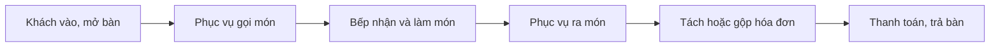

# Tổng quan nghiệp vụ — Quản lý Nhà hàng

> Mô tả demo này cho ai, giải quyết vấn đề gì. Cập nhật khi phạm vi thay đổi.

---

## 1. Thông tin chung

| Mục | Nội dung |
| :--- | :--- |
| Tên demo | Quản lý Nhà hàng |
| Mã dự án | `fnb-quan-ly-nha-hang` |
| Ngành / loại khách hàng | Nhà hàng, quán ăn có phục vụ tại bàn |
| Loại sản phẩm | Web quản lý + tablet cho phục vụ + màn hình bếp |
| Ý tưởng gốc | 1.2 · Quản lý nhà hàng (`ZDOCS/02-KE-HOACH/DANH-SACH-Y-TUONG.md`) |
| Người phụ trách | |
| Trạng thái | Mới tạo từ khuôn mẫu |

## 2. Vấn đề của khách hàng

- Phục vụ chạy qua lại báo món cho bếp, dễ sót món
- Không nắm được bàn nào trống, bàn nào đang phục vụ
- Khách đòi tách, gộp hóa đơn thì tính sai
- Món ra chậm nhưng không ai theo dõi

## 3. Giải pháp demo thể hiện

- Sơ đồ bàn theo khu vực, màu theo trạng thái
- Gọi món theo bàn trên tablet, gửi thẳng xuống bếp
- Màn hình bếp nhận món theo thời gian thực, cảnh báo món chờ lâu
- Chuyển bàn, gộp bàn, tách hóa đơn
- Thanh toán và báo cáo doanh thu

## 4. Vai trò người dùng

| Vai trò | Mã | Dùng trên | Làm được gì |
| :--- | :--- | :--- | :--- |
| Quản trị viên | ADMIN | Desktop | Toàn quyền |
| Quản lý | MANAGER | Desktop | Thực đơn, sơ đồ bàn, báo cáo |
| Phục vụ | WAITER | Tablet | Mở bàn, gọi món, chuyển/gộp bàn |
| Bếp | KITCHEN | Màn hình bếp | Nhận món, báo xong |
| Thu ngân | CASHIER | Tablet | Tách hóa đơn, thanh toán |

## 5. Phân hệ và chức năng

| Area | Chức năng | Màn hình (route FE dự kiến) | Ưu tiên |
| :--- | :--- | :--- | :---: |
| `System` | Đăng nhập, tài khoản, vai trò, cài đặt | Có sẵn | — |
| `Pos` | Khu vực, sơ đồ bàn | `/tables` | P1 |
| `Pos` | Thực đơn | `/menu-items` | P1 |
| `Pos` | Gọi món theo bàn | `/tables/[id]` | P1 |
| `Pos` | Màn hình bếp | `/kitchen` | P1 |
| `Pos` | Chuyển bàn, gộp bàn, tách hóa đơn | `/tables/[id]` | P1 |
| `Pos` | Thanh toán | `/tables/[id]/checkout` | P1 |
| `Pos` | Đặt bàn trước | `/reservations` | P2 |
| `Pos` | Báo cáo doanh thu, món | `/reports` | P2 |

P1 = bắt buộc có để demo · P2 = nên có · P3 = làm thêm nếu còn thời gian.

## 6. Luồng nghiệp vụ chính

## 7. Phạm vi

**Có trong demo:**

- Sơ đồ bàn, gọi món, màn hình bếp chạy qua lại giữa các tab
- Tách, gộp hóa đơn và thanh toán

**Không làm (nói rõ với khách nếu được hỏi):**

- Máy in bếp thật
- Kết nối app giao đồ ăn
- Các kết nối bên ngoài khác chỉ giả lập

## 8. Dữ liệu mẫu cần chuẩn bị

| Dữ liệu | Số lượng | Ghi chú |
| :--- | :---: | :--- |
| Khu vực | 3 | Tầng 1, tầng 2, sân vườn |
| Bàn | 30 |  |
| Món | 60 | Có ảnh |
| Hóa đơn | ~2.500 | 90 ngày, đông giờ trưa và tối |
| Đặt bàn | 50 |  |
