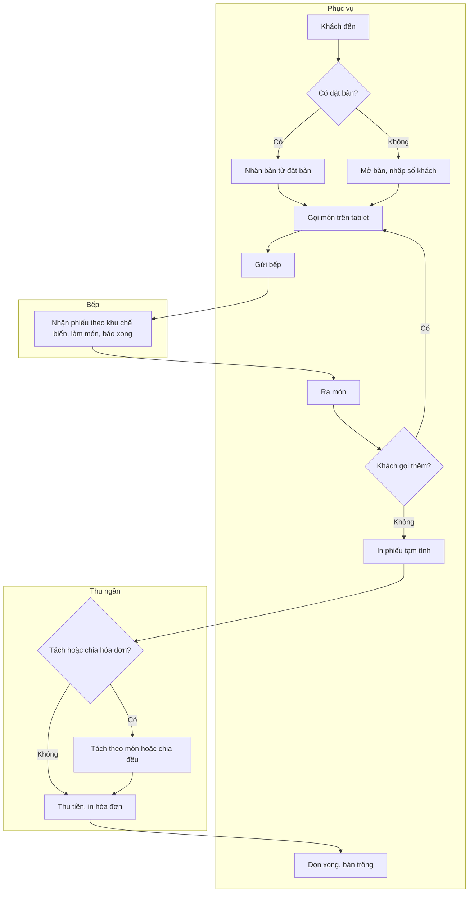
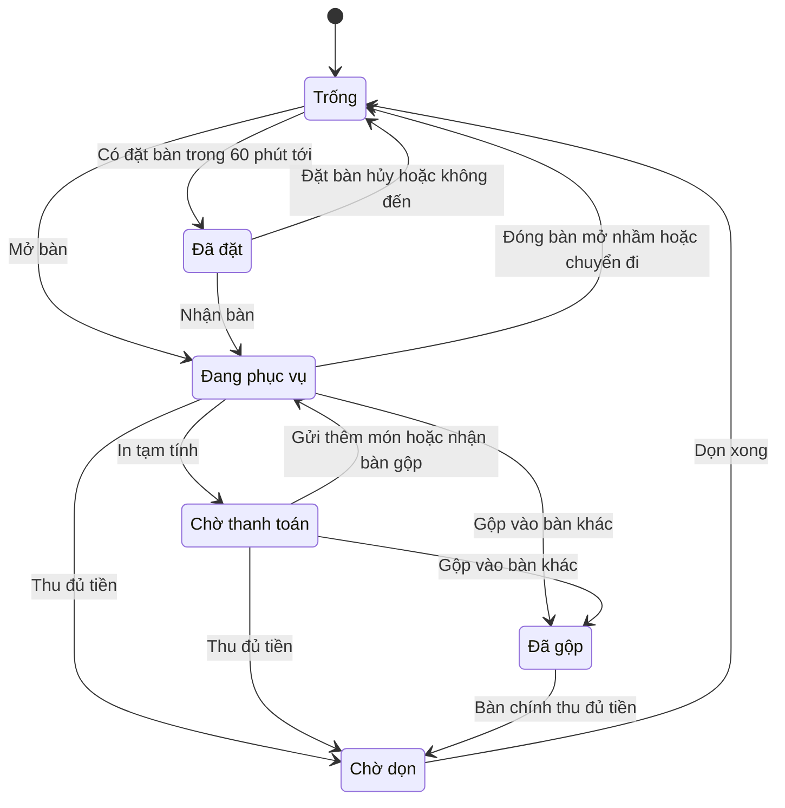
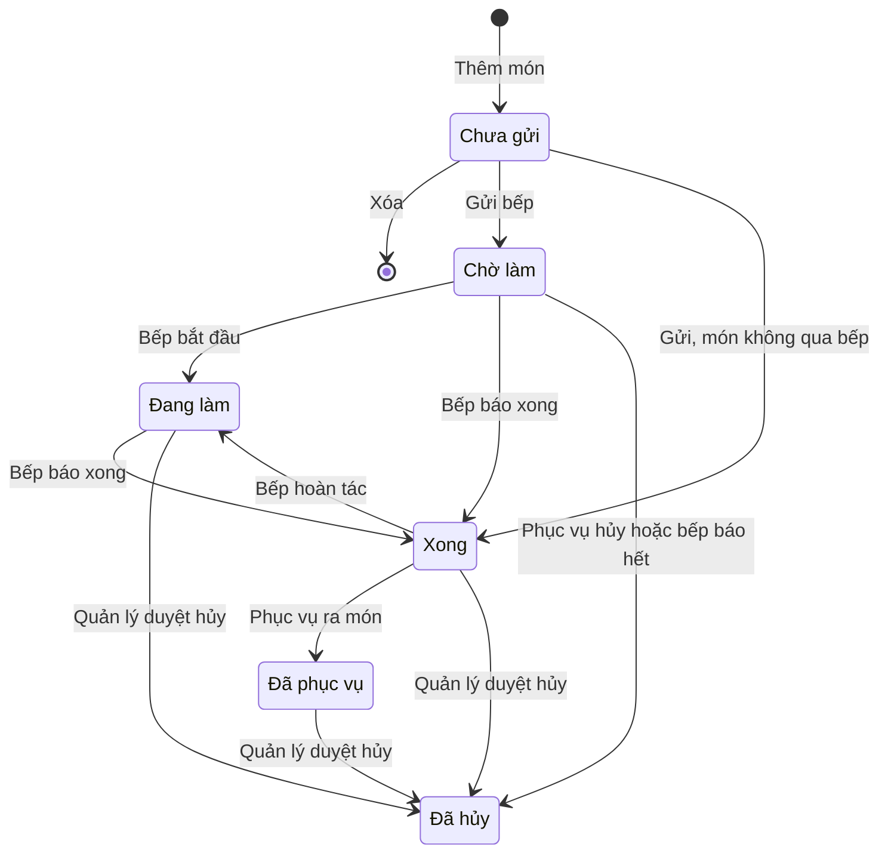
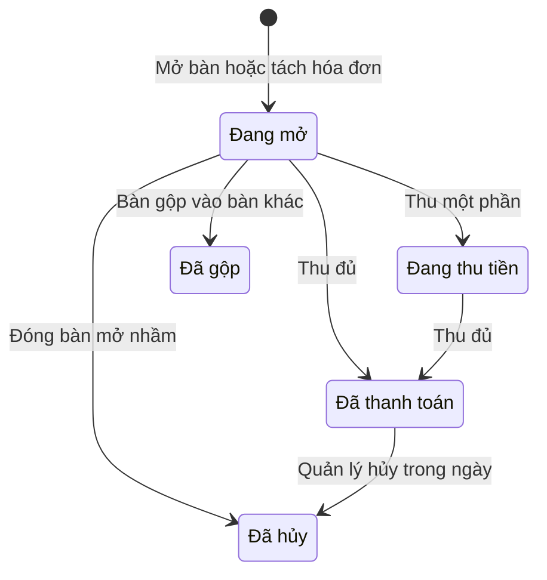

# Đặc tả yêu cầu phần mềm (SRS) — Quản lý Nhà hàng

| Phiên bản | Ngày | Trạng thái |
| :--- | :--- | :--- |
| 1.0 | 12/10/2026 | Bản nháp để triển khai demo |

> Cách viết, quy ước mã, mức độ chi tiết: `ZDOCS/05-HUONG-DAN/HUONG-DAN-VIET-TAI-LIEU-NGHIEP-VU.md`.
> Phần nền (đăng nhập, tài khoản, vai trò, cài đặt, đặt lại dữ liệu demo): `ZDOCS/03-KIEN-TRUC/USE-CASE-NEN.md`, không viết lại ở đây.

---

## 1. Giới thiệu

### 1.1. Mục đích

Tài liệu mô tả đầy đủ yêu cầu của bản demo Quản lý Nhà hàng: sơ đồ bàn, gọi món tại bàn, màn hình bếp, chuyển và gộp bàn, tách hóa đơn, cách tính phí phục vụ và thuế, dữ liệu, báo cáo, phân quyền và màn hình. Dev dùng để code, tester dùng để viết và chạy test case, sales dùng để biết demo làm được gì.

### 1.2. Phạm vi

**Trong phạm vi:** khu vực và sơ đồ bàn, thực đơn (món theo suất và theo trọng lượng), mở bàn, gọi món trên tablet, gửi bếp tách theo khu chế biến, màn hình bếp có cảnh báo món trễ, ra món, hủy món có quản lý duyệt, chuyển bàn, gộp bàn, chuyển món, tách hóa đơn theo món, chia đều, phiếu tạm tính, thanh toán nhiều phương thức có phí phục vụ và thuế GTGT, tra cứu hóa đơn, đặt bàn trước (P2), tổng quan và báo cáo (P2).

**Ngoài phạm vi:** máy in bếp và máy in hóa đơn thật (in qua trình duyệt), cổng thanh toán và máy POS ngân hàng (giả lập), hóa đơn điện tử, ca làm và đối soát tiền mặt (đã có ở demo POS Quán Cafe), khuyến mãi, voucher, tích điểm, kho nguyên liệu và định lượng món, app giao đồ ăn, khách tự gọi món qua QR (đã có ở demo Menu QR Gọi món), nhiều chi nhánh.

### 1.3. Thuật ngữ

| Thuật ngữ | Giải thích |
| :--- | :--- |
| Khu vực | Nhóm bàn theo vị trí: Tầng 1, Tầng 2, Sân vườn |
| Sơ đồ bàn | Bố trí bàn của một khu vực, mỗi bàn là một thẻ có màu theo trạng thái |
| Mở bàn | Ghi nhận khách ngồi vào bàn và tạo hóa đơn cho bàn |
| Hóa đơn | Toàn bộ món và tiền của một bàn (hoặc một phần sau khi tách) từ lúc mở bàn tới lúc thanh toán |
| Món gọi | Một dòng món trong hóa đơn kèm số lượng, ghi chú, trạng thái chế biến |
| Món theo trọng lượng | Món tính tiền theo số kg thực tế khi cân, vd cá, tôm, cua |
| Khu chế biến | Nơi làm món: Bếp nóng, Bếp nguội, Quầy bar; "Không qua bếp" dành cho bia, nước đóng chai lấy thẳng từ tủ |
| Phiếu bếp | Danh sách món của một lần gửi bếp cho một khu chế biến |
| Lần gọi | Số thứ tự lần gửi bếp của một hóa đơn: lần 1, lần 2… |
| Thời gian chế biến chuẩn | Thời gian dự kiến tối đa để làm xong một món, dùng để cảnh báo trễ |
| Món trễ | Món đã chờ bằng hoặc lâu hơn thời gian chế biến chuẩn mà bếp chưa báo xong |
| Ra món | Phục vụ mang món đã xong ra bàn |
| Hủy món | Bỏ món đã gửi bếp khỏi hóa đơn, bắt buộc có lý do |
| Phiếu tạm tính | Bản in tiền tạm tính cho khách kiểm tra trước khi thanh toán, chưa phải hóa đơn |
| Chuyển bàn | Đưa toàn bộ hóa đơn sang một bàn trống khác |
| Gộp bàn | Nhập món và khách của nhiều bàn vào một bàn chính để thanh toán chung |
| Bàn chính, bàn phụ | Bàn giữ hóa đơn sau khi gộp; bàn đã gộp vào bàn chính |
| Tách hóa đơn | Chia món của một hóa đơn thành nhiều hóa đơn thanh toán riêng |
| Chia đều | Chia tổng thanh toán của một hóa đơn thành N phần gần bằng nhau, mỗi phần thu riêng |
| Tiền món | Tổng thành tiền các món đã gửi bếp, chưa hủy |
| Phí phục vụ | Phần trăm cộng thêm trên tiền món sau giảm giá, mặc định 5% |
| Lượt thu | Một lần thu tiền bằng một phương thức: tiền mặt, chuyển khoản, thẻ, tiền cọc |
| Doanh thu thuần | Tiền món trừ giảm giá của hóa đơn đã thanh toán |
| Lượt phục vụ | Một lần mở bàn tới lúc thanh toán xong, dùng để tính vòng quay bàn |

### 1.4. Tài liệu liên quan

| Tài liệu | Nội dung |
| :--- | :--- |
| `01-TONG-QUAN-NGHIEP-VU.md` | Tổng quan nghiệp vụ |
| `03-USE-CASE.md` | Đặc tả use case |
| `05-KICH-BAN-KIEM-THU.md` | Test case nghiệm thu |
| `ZDOCS/03-KIEN-TRUC/USE-CASE-NEN.md` | Phần nền dùng chung |

---

## 2. Mô tả tổng quan

### 2.1. Bối cảnh sản phẩm

Nhà hàng 80–150 chỗ, hai tầng và sân vườn, 6–10 phục vụ mỗi ca. Bếp chia bếp nóng, bếp nguội và quầy bar. Mỗi phục vụ cầm một tablet để mở bàn, gọi món và nhận báo món xong. Bếp nóng và quầy bar mỗi nơi có một màn hình treo tường thay cho phiếu giấy. Thu ngân dùng tablet ở quầy, cạnh máy in hóa đơn. Quản lý theo dõi trên máy tính. Bản demo chạy một nhà hàng.

### 2.2. Tác nhân

| Mã vai trò | Tên | Thiết bị | Mục tiêu khi dùng hệ thống |
| :--- | :--- | :--- | :--- |
| `ADMIN` | Quản trị viên | Desktop | Cấu hình hệ thống, tài khoản, phân quyền, phí phục vụ và thuế suất |
| `MANAGER` | Quản lý | Desktop, tablet | Thiết lập bàn và thực đơn, duyệt hủy món và giảm giá, theo dõi vận hành, xem báo cáo |
| `WAITER` | Phục vụ | Tablet 8–10 inch | Mở bàn, gọi món đúng và nhanh, ra món kịp, chuyển và gộp bàn |
| `KITCHEN` | Bếp | Màn hình bếp (TV hoặc tablet lớn) | Nhận món rõ ràng theo thứ tự, không sót món, báo xong, báo hết món |
| `CASHIER` | Thu ngân | Tablet tại quầy | Tách hóa đơn, thu đúng tiền, trả bàn nhanh, nhận đặt bàn qua điện thoại |

Tài khoản demo: `admin`, `quanly`, `phucvu`, `bep`, `thungan`. Vai trò `STAFF` của phần nền không dùng trong dự án này. Sau khi đăng nhập, Quản lý vào Tổng quan, Phục vụ và Thu ngân vào Sơ đồ bàn, Bếp vào Màn hình bếp.

### 2.3. Quy trình nghiệp vụ

### 2.4. Giả định và ràng buộc

- Một nhà hàng, 3 khu vực, 30 bàn; mỗi nhân viên dùng một tài khoản riêng.
- Giá món là bội số của 1.000 ₫ và chưa gồm thuế GTGT. Phí phục vụ mặc định 5%, thuế suất GTGT mặc định 8%; quản trị viên đổi được khi chính sách thay đổi.
- Khu chế biến là danh sách cố định: Bếp nóng, Bếp nguội, Quầy bar, Không qua bếp.
- Màn hình bếp thay cho máy in bếp. Phiếu tạm tính và hóa đơn in bằng lệnh in của trình duyệt, khổ 80 mm.
- QR chuyển khoản là ảnh giả lập theo định dạng VietQR; thanh toán thẻ giả lập máy POS ngân hàng. Thu ngân tự xác nhận đã nhận tiền.
- Tiền cọc đặt bàn chỉ ghi nhận, không thu online.
- Không quản lý tồn kho: món chỉ có trạng thái còn bán, tạm hết hoặc ẩn.

---

## 3. Yêu cầu chức năng

### 3.1. Tổng quan

| Mã | Yêu cầu | Ưu tiên | Vai trò | UC |
| :--- | :--- | :---: | :--- | :--- |
| FR-01 | Hệ thống hiển thị số bàn đang phục vụ trên tổng số bàn, số khách đang ngồi, doanh thu thuần hôm nay, số hóa đơn đã thanh toán, doanh thu trung bình mỗi khách, số món đang chờ bếp, số món trễ, thời gian ra món trung bình hôm nay và 5 bàn ngồi lâu nhất | P2 | MANAGER | UC-14 |

### 3.2. Khu vực và sơ đồ bàn

| Mã | Yêu cầu | Ưu tiên | Vai trò | UC |
| :--- | :--- | :---: | :--- | :--- |
| FR-02 | Hệ thống cho phép quản lý thêm, sửa, ẩn, sắp xếp thứ tự khu vực (mã, tên) | P1 | MANAGER | UC-01 |
| FR-03 | Hệ thống cho phép quản lý thêm, sửa, ẩn bàn với mã bàn, khu vực, sức chứa, hình dạng (vuông, tròn, chữ nhật) và kéo thả vị trí bàn trên sơ đồ | P1 | MANAGER | UC-01 |
| FR-04 | Sơ đồ bàn hiển thị bàn theo tab khu vực, màu theo trạng thái; thẻ bàn có mã bàn, số khách, thời gian ngồi, tạm tính, số món chờ ra, biểu tượng món trễ; có thanh đếm và lọc theo trạng thái; tự cập nhật không cần tải lại trang | P1 | WAITER, CASHIER, MANAGER | UC-02 |
| FR-05 | Phục vụ mở bàn trống bằng cách nhập số khách; hệ thống tạo hóa đơn gắn với bàn và phục vụ đang đăng nhập. Bàn mở nhầm đóng được khi chưa gửi bếp món nào | P1 | WAITER | UC-02 |

### 3.3. Thực đơn

| Mã | Yêu cầu | Ưu tiên | Vai trò | UC |
| :--- | :--- | :---: | :--- | :--- |
| FR-06 | Hệ thống cho phép quản lý thêm, sửa, ẩn, sắp xếp thứ tự danh mục món | P1 | MANAGER | UC-03 |
| FR-07 | Hệ thống cho phép quản lý thêm, sửa, ẩn món với mã, tên, danh mục, ảnh, mô tả, đơn vị tính, cách tính (theo suất hoặc theo trọng lượng), đơn giá, khu chế biến, thời gian chế biến chuẩn | P1 | MANAGER | UC-03 |
| FR-08 | Quản lý khai báo danh sách ghi chú nhanh (ít cay, không hành, không ngò, ít đá…) để phục vụ chọn khi gọi món | P2 | MANAGER | UC-03 |
| FR-09 | Bếp và quản lý đánh dấu món tạm hết và bán lại; món tạm hết hiển thị mờ, không gọi được trên tablet phục vụ | P1 | KITCHEN, MANAGER | UC-04 |
| FR-10 | Bếp báo hết một món đang chờ làm ngay trên phiếu bếp: món chuyển "Đã hủy" với lý do "Hết món" và phục vụ của bàn nhận thông báo | P2 | KITCHEN | UC-04 |

### 3.4. Gọi món

| Mã | Yêu cầu | Ưu tiên | Vai trò | UC |
| :--- | :--- | :---: | :--- | :--- |
| FR-11 | Màn gọi món của bàn hiển thị thực đơn dạng lưới có ảnh, lọc theo danh mục, tìm theo tên hoặc mã; bên cạnh là danh sách món của bàn chia hai phần "Chưa gửi bếp" và "Đã gửi bếp" kèm trạng thái từng món | P1 | WAITER | UC-05 |
| FR-12 | Phục vụ thêm món với số lượng (món theo trọng lượng nhập số kg), ghi chú tự do, ghi chú nhanh, đánh dấu "Gấp"; sửa hoặc xóa món chưa gửi bếp | P1 | WAITER | UC-05 |
| FR-13 | Phục vụ bấm "Gửi bếp": hệ thống tạo phiếu bếp cho từng khu chế biến và hiển thị ngay trên màn hình bếp tương ứng; gọi thêm được nhiều lần, mỗi lần gửi ghi số lần gọi trên phiếu | P1 | WAITER | UC-05 |
| FR-14 | Phục vụ gửi món ở chế độ "Chờ gọi" (vd món chính ra sau khai vị) và bấm "Gọi món" khi cần bếp làm | P3 | WAITER, KITCHEN | UC-16 |

### 3.5. Màn hình bếp

| Mã | Yêu cầu | Ưu tiên | Vai trò | UC |
| :--- | :--- | :---: | :--- | :--- |
| FR-15 | Màn hình bếp hiển thị phiếu bếp dạng thẻ, mỗi thẻ có mã bàn, lần gọi, tên phục vụ, giờ gửi, đồng hồ thời gian chờ, món kèm số lượng và ghi chú; lọc theo khu chế biến (Bếp nóng, Bếp nguội, Quầy bar, Tất cả); phát âm báo khi có phiếu mới | P1 | KITCHEN | UC-06 |
| FR-16 | Bếp bấm "Bắt đầu", "Xong" cho từng món hoặc "Xong cả phiếu"; phiếu xong chuyển sang danh sách "Đã xong" và hoàn tác được khi món chưa ra | P1 | KITCHEN | UC-06 |
| FR-17 | Hệ thống đổi màu món và phiếu theo thời gian chờ so với thời gian chế biến chuẩn (xanh, vàng, đỏ); thẻ bàn trên sơ đồ có biểu tượng món trễ | P1 | KITCHEN, WAITER | UC-06 |
| FR-18 | Màn hình bếp có chế độ tổng hợp số lượng từng món đang chờ để bếp làm theo mẻ, chạm một món thấy danh sách bàn | P2 | KITCHEN | UC-06 |

### 3.6. Ra món và hủy món

| Mã | Yêu cầu | Ưu tiên | Vai trò | UC |
| :--- | :--- | :---: | :--- | :--- |
| FR-19 | Phục vụ thấy số dòng món chờ ra trên thẻ bàn và trong danh sách "Món chờ ra" (mặc định lọc bàn của mình), có âm báo khi món xong; bấm "Đã ra" từng món hoặc "Ra hết" cả bàn | P1 | WAITER | UC-07 |
| FR-20 | Phục vụ hủy món đã gửi bếp khi bếp chưa bắt đầu làm, bắt buộc chọn lý do (Khách đổi ý, Gọi nhầm, Chờ lâu, Khác kèm ghi chú) | P1 | WAITER | UC-08 |
| FR-21 | Hủy món bếp đang làm, đã xong hoặc đã ra cần quản lý xác nhận bằng tài khoản ngay trên tablet; hệ thống lưu người hủy, người duyệt, lý do, trạng thái lúc hủy | P1 | WAITER, MANAGER | UC-08 |

### 3.7. Chuyển bàn, gộp bàn, tách hóa đơn

| Mã | Yêu cầu | Ưu tiên | Vai trò | UC |
| :--- | :--- | :---: | :--- | :--- |
| FR-22 | Phục vụ chuyển toàn bộ hóa đơn sang bàn trống khác; phiếu bếp đang chờ hiển thị mã bàn mới | P1 | WAITER, CASHIER | UC-09 |
| FR-23 | Phục vụ gộp một hoặc nhiều bàn đang phục vụ vào một bàn chính để thanh toán chung | P1 | WAITER, CASHIER | UC-09 |
| FR-24 | Phục vụ chuyển một số món (chọn số lượng) sang bàn khác đang phục vụ | P2 | WAITER | UC-09 |
| FR-25 | Thu ngân tách hóa đơn theo món: chọn món và số lượng chuyển sang hóa đơn mới cùng bàn; mỗi hóa đơn tính tiền và thanh toán riêng | P1 | CASHIER | UC-10 |
| FR-26 | Thu ngân chia đều hóa đơn cho 2–20 người; mỗi phần thu riêng bằng phương thức riêng | P1 | CASHIER | UC-10 |

### 3.8. Thanh toán và hóa đơn

| Mã | Yêu cầu | Ưu tiên | Vai trò | UC |
| :--- | :--- | :---: | :--- | :--- |
| FR-27 | Phục vụ hoặc thu ngân in phiếu tạm tính khổ 80 mm; bàn chuyển "Chờ thanh toán" | P1 | WAITER, CASHIER | UC-11 |
| FR-28 | Màn thanh toán hiển thị danh sách món, tiền món, giảm giá, phí phục vụ, thuế GTGT, làm tròn, tiền cọc, tổng thanh toán và số còn phải thu | P1 | CASHIER | UC-11 |
| FR-29 | Thu ngân giảm giá hóa đơn theo phần trăm hoặc số tiền, có lý do; vượt hạn mức cần quản lý xác nhận bằng tài khoản | P2 | CASHIER, MANAGER | UC-11 |
| FR-30 | Thu ngân thu bằng tiền mặt (nút mệnh giá nhanh, hiện tiền thối), chuyển khoản QR (giả lập), thẻ ngân hàng (giả lập) hoặc kết hợp nhiều lượt thu tới khi đủ | P1 | CASHIER | UC-11 |
| FR-31 | Thu đủ tiền thì hệ thống chốt hóa đơn, mở bản in hóa đơn khổ 80 mm, bàn chuyển "Chờ dọn"; phục vụ bấm "Dọn xong" để bàn về "Trống" | P1 | CASHIER, WAITER | UC-11 |
| FR-32 | Quản trị viên cài đặt tỉ lệ phí phục vụ (0–15%), thuế suất GTGT (0%, 5%, 8%, 10%) và hạn mức giảm giá của thu ngân trong Cài đặt chung | P2 | ADMIN | UC-SYS-07 |
| FR-33 | Thu ngân và quản lý tra cứu hóa đơn theo mã, bàn, ngày, trạng thái; xem chi tiết, in lại; quản lý hủy hóa đơn đã thanh toán trong ngày, bắt buộc lý do | P2 | CASHIER, MANAGER | UC-12 |

### 3.9. Đặt bàn

| Mã | Yêu cầu | Ưu tiên | Vai trò | UC |
| :--- | :--- | :---: | :--- | :--- |
| FR-34 | Quản lý và thu ngân tạo, sửa, hủy đặt bàn: tên khách, số điện thoại, giờ đến, số khách, bàn, ghi chú, tiền cọc (chỉ ghi nhận) | P2 | MANAGER, CASHIER | UC-13 |
| FR-35 | Danh sách đặt bàn theo ngày dạng dòng thời gian theo bàn; bàn có đặt trong 60 phút tới hiển thị "Đã đặt" trên sơ đồ bàn | P2 | MANAGER, CASHIER, WAITER | UC-13 |
| FR-36 | Khi khách đến, phục vụ hoặc thu ngân nhận bàn từ đặt bàn: hệ thống mở bàn với số khách, ghi chú, tiền cọc đã đặt | P2 | WAITER, CASHIER | UC-13 |

### 3.10. Báo cáo

| Mã | Yêu cầu | Ưu tiên | Vai trò | UC |
| :--- | :--- | :---: | :--- | :--- |
| FR-37 | Báo cáo doanh thu theo ngày trong khoảng chọn: doanh thu thuần, số hóa đơn, số khách, doanh thu trung bình mỗi khách, giảm giá, phí phục vụ, thuế GTGT, so với kỳ liền trước cùng độ dài | P2 | MANAGER | UC-15 |
| FR-38 | Báo cáo món bán chạy (số lượng, doanh thu, tỉ trọng) và báo cáo món hủy (số lượng, giá trị, lý do, người hủy, người duyệt, trạng thái lúc hủy) | P2 | MANAGER | UC-15 |
| FR-39 | Báo cáo vận hành bếp: thời gian ra món trung bình theo khu chế biến và theo món, tỉ lệ món trễ theo khung giờ | P2 | MANAGER | UC-15 |
| FR-40 | Báo cáo khu vực và bàn: doanh thu, số lượt phục vụ, vòng quay bàn, thời gian ngồi trung bình | P3 | MANAGER | UC-15 |

---

## 4. Quy tắc nghiệp vụ

| Mã | Quy tắc | Áp dụng cho |
| :--- | :--- | :--- |
| BR-01 | Chỉ mở được bàn đang "Trống" hoặc "Đã đặt". Số khách từ 1 đến 50; lớn hơn sức chứa của bàn thì cảnh báo, phục vụ xác nhận vẫn mở được | FR-05 |
| BR-02 | Trạng thái bàn: Trống → Đang phục vụ (mở bàn) → Chờ thanh toán (in tạm tính) → Chờ dọn (thu đủ tiền) → Trống (dọn xong). Bàn trống có đặt bàn "Chờ đến" với giờ đến trong 60 phút tới hiển thị "Đã đặt". Chi tiết ở §5.2 | FR-04, FR-35 |
| BR-03 | Mã hóa đơn cấp khi mở bàn hoặc khi tách hóa đơn. Đóng bàn mở nhầm chỉ được khi chưa gửi bếp món nào; hóa đơn chuyển "Đã hủy" với lý do "Mở nhầm", không xóa | FR-05, FR-25 |
| BR-04 | Thành tiền một dòng = đơn giá × số lượng. Món theo suất: số lượng nguyên từ 1 đến 99. Món theo trọng lượng: từ 0,1 đến 20 kg, bước 0,1 kg; thành tiền làm tròn tới 1.000 ₫ gần nhất | FR-12 |
| BR-05 | Tiền món = tổng thành tiền các món đã gửi bếp, không gồm món "Đã hủy". Món "Chưa gửi" không tính vào tạm tính và thanh toán | FR-27, FR-28 |
| BR-06 | Phí phục vụ = (Tiền món − Giảm giá) × tỉ lệ phí phục vụ (mặc định 5%). Thuế GTGT = (Tiền món − Giảm giá + Phí phục vụ) × thuế suất (mặc định 8%). Hai khoản tính tới 1 ₫, phần lẻ từ 0,5 ₫ làm tròn lên | FR-28, FR-32 |
| BR-07 | Tổng thanh toán = Tiền món − Giảm giá + Phí phục vụ + Thuế GTGT, làm tròn tới 1.000 ₫ gần nhất (phần lẻ từ 500 ₫ làm tròn lên). Chênh lệch do làm tròn in thành dòng "Làm tròn" | FR-28 |
| BR-08 | Giảm giá tính trên Tiền món, mỗi hóa đơn một khoản giảm. Giảm theo phần trăm làm tròn xuống tới bội số 1.000 ₫. Thu ngân tự giảm tối đa 10% Tiền món; vượt mức cần tài khoản có quyền `orders.discount-override` xác nhận | FR-29 |
| BR-09 | Mỗi lần gửi bếp tạo một phiếu cho mỗi khu chế biến có món trong lần gửi. Món thuộc "Không qua bếp" không tạo phiếu, chuyển thẳng "Xong" và vào danh sách "Món chờ ra". Lần gọi của hóa đơn tăng 1 sau mỗi lần gửi | FR-13 |
| BR-10 | Trạng thái món gọi: Chưa gửi → Chờ làm → Đang làm → Xong → Đã phục vụ. Bếp được bấm "Xong" khi món còn "Chờ làm". Hoàn tác "Xong" về "Đang làm" chỉ khi món chưa ra. Phiếu bếp vào danh sách "Đã xong" khi mọi món trên phiếu "Xong" hoặc "Đã hủy" | FR-16, FR-19 |
| BR-11 | Thời gian chờ = thời điểm hiện tại − giờ gửi bếp, tính cho món "Chờ làm" và "Đang làm". Xanh: dưới 80% thời gian chuẩn; vàng: từ 80% đến dưới 100%; đỏ (nhãn "Trễ"): từ 100% trở lên. Màu phiếu là màu nặng nhất trong các món của phiếu. Thời gian chuẩn mặc định 15 phút, đồ uống quầy bar 5 phút | FR-01, FR-17 |
| BR-12 | Thứ tự phiếu trên màn hình bếp: phiếu có món "Gấp" xếp trước; cùng mức ưu tiên thì phiếu gửi sớm xếp trước | FR-15 |
| BR-13 | Hủy món: món "Chưa gửi" xóa hẳn, không lưu. Món "Chờ làm": phục vụ hủy, bắt buộc lý do. Món "Đang làm", "Xong", "Đã phục vụ": cần tài khoản có quyền `order-items.void-approve`. Món hủy không tính tiền, vẫn lưu người hủy, người duyệt, lý do, thời điểm, trạng thái lúc hủy. Món theo suất hủy được một phần số lượng; món theo trọng lượng hủy nguyên dòng. Trên màn hình bếp, món hủy hiện gạch ngang, nhãn "ĐÃ HỦY" tới khi bếp bấm "Đã biết" | FR-20, FR-21 |
| BR-14 | Bếp chỉ báo hết được món đang "Chờ làm". Món chuyển "Đã hủy" với lý do "Hết món", không cần duyệt; món đó tự chuyển "Tạm hết" trên thực đơn | FR-10 |
| BR-15 | Chuyển bàn: bàn đích phải "Trống" hoặc "Đã đặt" (có cảnh báo giờ đặt). Hóa đơn giữ nguyên mã, món, trạng thái món; phiếu bếp đang chờ hiển thị mã bàn mới kèm "từ {bàn cũ}"; bàn cũ về "Trống" | FR-22 |
| BR-16 | Gộp bàn: chỉ gộp bàn "Đang phục vụ" hoặc "Chờ thanh toán". Món và số khách của bàn phụ chuyển sang hóa đơn bàn chính; hóa đơn bàn phụ chuyển "Đã gộp"; bàn phụ hiển thị "Đã gộp → {mã bàn chính}", chạm vào mở hóa đơn bàn chính. Bàn chính đang "Chờ thanh toán" quay về "Đang phục vụ". Bàn chính thu đủ tiền thì mọi bàn phụ cùng chuyển "Chờ dọn". Không tách bàn sau khi gộp | FR-23 |
| BR-17 | Chuyển món: bàn đích phải "Đang phục vụ" hoặc "Chờ thanh toán"; món giữ nguyên trạng thái chế biến; món theo trọng lượng chuyển nguyên dòng | FR-24 |
| BR-18 | Tách hóa đơn theo món: hóa đơn gốc phải còn ít nhất 1 món; dòng có số lượng lớn hơn 1 tách được một phần theo số nguyên; món theo trọng lượng chỉ tách nguyên dòng; tối đa 10 hóa đơn mỗi bàn. Giảm giá trên hóa đơn gốc bị gỡ khi tách. Mỗi hóa đơn tính phí phục vụ, thuế, làm tròn riêng theo BR-06, BR-07. Số khách và tiền cọc ở lại hóa đơn gốc | FR-25 |
| BR-19 | Chia đều N phần, N từ 2 đến 20. Số tiền cần chia = Tổng thanh toán − tiền cọc. Mỗi phần = số tiền cần chia ÷ N, làm tròn xuống tới 1.000 ₫; phần dư cộng vào phần 1. Hủy chia đều chỉ được khi chưa thu phần nào | FR-26 |
| BR-20 | Thu tiền: chuyển khoản và thẻ không vượt số còn phải thu. Tiền mặt nhỏ hơn số còn phải thu được ghi là thu một phần sau khi thu ngân xác nhận; lớn hơn thì tiền thối = tiền khách đưa − số còn phải thu. QR chuyển khoản có số tiền của lượt thu, nội dung là mã hóa đơn. Hóa đơn "Đã thanh toán" khi số còn phải thu bằng 0 | FR-30, FR-31 |
| BR-21 | Không in tạm tính, tách hóa đơn, thanh toán khi hóa đơn còn món "Chưa gửi". Còn món "Chờ làm" hoặc "Đang làm" thì cảnh báo "Còn {n} món bếp chưa xong", vẫn cho tiếp tục. Gửi thêm món sau khi in tạm tính: bàn về "Đang phục vụ", phiếu tạm tính đã in hết hiệu lực | FR-27, FR-28, FR-30 |
| BR-22 | Hóa đơn đã có lượt thu (không tính tiền cọc) bị khóa: không thêm món, hủy món, giảm giá, tách, chia lại, chuyển bàn, gộp bàn | FR-21, FR-22, FR-23, FR-25, FR-26 |
| BR-23 | Hủy hóa đơn đã thanh toán: chỉ quản lý, chỉ hóa đơn thanh toán trong ngày hiện tại, bắt buộc lý do. Hóa đơn hủy không tính doanh thu | FR-33 |
| BR-24 | Đặt bàn: giờ đến nằm trong giờ mở cửa (mặc định 10:00–22:00) và cách thời điểm tạo ít nhất 30 phút. Mỗi đặt bàn giữ bàn 120 phút tính từ giờ đến; hai đặt bàn cùng bàn không được chồng thời gian. Quá giờ đến 15 phút chưa nhận bàn: gắn nhãn "Trễ". Quá 30 phút: tự chuyển "Không đến", bàn được giải phóng | FR-34, FR-35 |
| BR-25 | Tiền cọc từ 0 đến 5.000.000 ₫, bội số 1.000 ₫. Khi nhận bàn, tiền cọc ghi vào hóa đơn; ở màn thanh toán hệ thống tự tạo lượt thu "Tiền cọc". Cọc lớn hơn tổng thanh toán thì phần dư hoàn tiền mặt cho khách | FR-36 |
| BR-26 | Doanh thu thuần = Tiền món − Giảm giá của hóa đơn đã thanh toán, tính theo thời điểm thanh toán; không gồm phí phục vụ, thuế GTGT, hóa đơn hủy. Số khách lấy từ hóa đơn gốc. Doanh thu trung bình mỗi khách = doanh thu thuần ÷ số khách | FR-01, FR-37 |
| BR-27 | Thời gian ra món = giờ bếp báo "Xong" − giờ gửi bếp; không tính món "Không qua bếp" và món hủy. Tỉ lệ trễ = số món có thời gian ra món từ thời gian chuẩn trở lên ÷ tổng số món đã xong. Vòng quay bàn = số lượt phục vụ ÷ số bàn đang dùng ÷ số ngày | FR-39, FR-40 |
| BR-28 | Món đã từng được gọi không xóa được, chỉ ẩn; món gọi lưu tên, đơn giá tại thời điểm gọi. Đơn giá là bội số 1.000 ₫ và lớn hơn 0; thời gian chuẩn từ 1 đến 120 phút. Mã bàn không trùng; sức chứa từ 1 đến 20. Bàn đang có hóa đơn mở không ẩn, xóa hoặc đổi khu vực được | FR-03, FR-07 |

---

## 5. Yêu cầu dữ liệu

### 5.1. Thực thể

| Thực thể | Mô tả | Thuộc tính chính | Quan hệ |
| :--- | :--- | :--- | :--- |
| Khu vực | Nhóm bàn theo vị trí | Mã, tên, thứ tự, hiển thị | Có nhiều bàn |
| Bàn | Bàn ăn trên sơ đồ | Mã bàn, sức chứa, hình dạng, vị trí (x, y), hiển thị, trạng thái phục vụ | Thuộc một khu vực; có nhiều hóa đơn, nhiều đặt bàn |
| Danh mục món | Nhóm món trên màn gọi món | Tên, thứ tự, hiển thị | Có nhiều món |
| Món | Món ăn, đồ uống bán ra | Mã, tên, ảnh, mô tả, đơn vị tính, cách tính (theo suất, theo trọng lượng), đơn giá, khu chế biến, thời gian chế biến chuẩn, trạng thái (đang bán, tạm hết, ẩn) | Thuộc một danh mục |
| Ghi chú nhanh | Ghi chú hay dùng khi gọi món | Nội dung, thứ tự | Dùng cho mọi món |
| Hóa đơn | Món và tiền của một bàn | Mã, số khách, giờ mở, giờ thanh toán, tiền món, giảm giá, lý do giảm, người duyệt giảm, tỉ lệ và tiền phí phục vụ, thuế suất và tiền thuế, làm tròn, tiền cọc, tổng thanh toán, số phần chia đều, trạng thái, lý do hủy | Gắn một bàn chính và các bàn phụ (khi gộp); do một phục vụ mở; có nhiều món gọi, nhiều lượt thu; có thể tách từ một hóa đơn gốc |
| Món gọi | Một dòng món trong hóa đơn | Tên món, đơn giá, số lượng, thành tiền, ghi chú, ghi chú nhanh, gấp, khu chế biến, lần gọi, trạng thái, giờ gửi, giờ bắt đầu, giờ xong, giờ ra, lý do hủy, người hủy, người duyệt hủy | Thuộc một hóa đơn; thuộc một phiếu bếp (trừ món không qua bếp) |
| Phiếu bếp | Món của một lần gửi cho một khu chế biến | Số phiếu, khu chế biến, lần gọi, giờ gửi, phục vụ, trạng thái (đang chờ, đã xong) | Thuộc một hóa đơn; có nhiều món gọi |
| Lượt thu | Một lần thu tiền | Phương thức (tiền mặt, chuyển khoản, thẻ, tiền cọc), số tiền, tiền khách đưa, tiền thối, 4 số cuối thẻ, phần số (khi chia đều), thời gian, thu ngân | Thuộc một hóa đơn |
| Đặt bàn | Khách giữ bàn trước | Mã, tên khách, số điện thoại, giờ đến, số khách, ghi chú, tiền cọc, trạng thái | Gắn một bàn; sinh một hóa đơn khi nhận bàn |
| Cài đặt tính tiền | Tham số tính tiền | Tỉ lệ phí phục vụ, thuế suất GTGT, hạn mức giảm của thu ngân, giờ mở cửa | Dùng chung, lưu trong Cài đặt chung |

Món gọi lưu tên món và đơn giá tại thời điểm gọi. Hóa đơn lưu tỉ lệ phí phục vụ, thuế suất tại thời điểm thanh toán. Đổi giá hoặc đổi cài đặt sau này không làm thay đổi hóa đơn cũ.

### 5.2. Vòng đời

**Bàn**

**Món gọi**

Món gửi ở chế độ "Chờ gọi" (P3, FR-14) có thêm trạng thái "Chờ gọi" giữa "Chưa gửi" và "Chờ làm".

**Hóa đơn**

**Đặt bàn:** Chờ đến → Đã nhận bàn (khách đến, mở bàn) hoặc Không đến (quá giờ đến 30 phút) hoặc Đã hủy (khách báo hủy). Nhãn "Trễ" chỉ để hiển thị, không phải trạng thái.

### 5.3. Mã chứng từ

| Chứng từ | Định dạng | Ví dụ |
| :--- | :--- | :--- |
| Hóa đơn | `HD` + `yyMMdd` + 4 số | `HD2610120042` |
| Phiếu bếp | `#` + 3 số, đánh lại từ `#001` mỗi ngày | `#087` |
| Đặt bàn | `DB` + `yyMMdd` + 3 số | `DB261012007` |
| Khu vực | 2 ký tự chữ in hoa và số | `T1`, `SV` |
| Bàn | Mã khu vực + `-` + 2 số | `T1-05` |
| Món | `M` + 3 số | `M015` |

---

## 6. Báo cáo

| Báo cáo | Chỉ số | Bộ lọc | Vai trò |
| :--- | :--- | :--- | :--- |
| Tổng quan hôm nay | Bàn đang phục vụ / tổng bàn, khách đang ngồi, doanh thu thuần, số hóa đơn, doanh thu trung bình mỗi khách, món đang chờ bếp, món trễ, thời gian ra món trung bình, 5 bàn ngồi lâu nhất | — | MANAGER |
| Doanh thu theo ngày | Doanh thu thuần, số hóa đơn, số khách, trung bình mỗi khách, giảm giá, phí phục vụ, thuế GTGT, so kỳ trước | Khoảng ngày | MANAGER |
| Món bán chạy | Số lượng, doanh thu, tỉ trọng | Khoảng ngày, danh mục | MANAGER |
| Món hủy | Món, số lượng, giá trị, lý do, người hủy, người duyệt, trạng thái lúc hủy | Khoảng ngày, lý do, nhân viên | MANAGER |
| Vận hành bếp | Thời gian ra món trung bình theo khu chế biến và theo món, tỉ lệ món trễ theo khung giờ | Khoảng ngày, khu chế biến | MANAGER |
| Khu vực và bàn (P3) | Doanh thu, lượt phục vụ, vòng quay bàn, thời gian ngồi trung bình theo khu vực và từng bàn | Khoảng ngày, khu vực | MANAGER |

---

## 7. Phân quyền

> Quyền nền (`dashboard`, `users`, `roles`, `settings`, `audit-logs`) xem `USE-CASE-NEN.md` §7.

| Mã quyền | Mô tả | ADMIN | MANAGER | WAITER | KITCHEN | CASHIER |
| :--- | :--- | :---: | :---: | :---: | :---: | :---: |
| `tables.view` | Xem sơ đồ bàn | ✓ | ✓ | ✓ | | ✓ |
| `tables.create` / `update` / `delete` | Thiết lập khu vực, bàn | ✓ | ✓ | | | |
| `tables.open` | Mở bàn, đóng bàn mở nhầm, báo dọn xong | ✓ | ✓ | ✓ | | ✓ |
| `tables.transfer` | Chuyển bàn, gộp bàn, chuyển món | ✓ | ✓ | ✓ | | ✓ |
| `menu-items.view` | Xem thực đơn | ✓ | ✓ | ✓ | ✓ | ✓ |
| `menu-items.create` / `update` / `delete` | Quản lý danh mục, món, ghi chú nhanh | ✓ | ✓ | | | |
| `menu-items.availability` | Báo tạm hết, bán lại | ✓ | ✓ | | ✓ | |
| `orders.view` | Xem hóa đơn (phục vụ chỉ thấy hóa đơn đang mở) | ✓ | ✓ | ✓ | | ✓ |
| `orders.create` | Gọi món, gửi bếp, ra món | ✓ | ✓ | ✓ | | ✓ |
| `order-items.cancel` | Hủy món chưa chế biến | ✓ | ✓ | ✓ | | ✓ |
| `order-items.void-approve` | Duyệt hủy món đã chế biến | ✓ | ✓ | | | |
| `orders.prebill` | In phiếu tạm tính | ✓ | ✓ | ✓ | | ✓ |
| `orders.split` | Tách hóa đơn, chia đều | ✓ | ✓ | | | ✓ |
| `orders.discount` | Giảm giá trong hạn mức | ✓ | ✓ | | | ✓ |
| `orders.discount-override` | Xác nhận giảm giá vượt hạn mức | ✓ | ✓ | | | |
| `orders.checkout` | Thu tiền, chốt hóa đơn | ✓ | ✓ | | | ✓ |
| `orders.reprint` | In lại hóa đơn | ✓ | ✓ | | | ✓ |
| `orders.cancel` | Hủy hóa đơn đã thanh toán | ✓ | ✓ | | | |
| `kitchen-tickets.view` | Xem màn hình bếp | ✓ | ✓ | | ✓ | |
| `kitchen-tickets.update` | Bắt đầu, xong, hoàn tác, báo hết món | ✓ | ✓ | | ✓ | |
| `reservations.view` | Xem đặt bàn | ✓ | ✓ | ✓ | | ✓ |
| `reservations.create` / `update` / `delete` | Tạo, sửa, hủy đặt bàn | ✓ | ✓ | | | ✓ |
| `reservations.check-in` | Nhận bàn từ đặt bàn | ✓ | ✓ | ✓ | | ✓ |
| `reports.view` | Xem tổng quan, báo cáo | ✓ | ✓ | | | |

---

## 8. Yêu cầu phi chức năng

> Yêu cầu chung (bảo mật JWT, phân quyền, tiếng Việt, chế độ dữ liệu mẫu) theo `ZDOCS/03-KIEN-TRUC/KIEN-TRUC-HE-THONG.md`. Ở đây chỉ ghi yêu cầu riêng của dự án.

| Mã | Yêu cầu |
| :--- | :--- |
| NFR-01 | Màn sơ đồ bàn và gọi món tối ưu cho tablet ngang 1280×800, dùng được ở chiều dọc 800×1280; vùng chạm tối thiểu 44×44 px; một khu vực tới 16 bàn hiển thị trọn màn hình không cần cuộn |
| NFR-02 | Màn hình bếp tối ưu 1920×1080, nền tối, tên món tối thiểu 20 px đọc được từ khoảng cách 2 m, hiển thị cùng lúc ít nhất 8 phiếu; thao tác bằng chạm hoặc chuột; không tự đăng xuất trong ca làm |
| NFR-03 | Món gửi bếp xuất hiện trên màn hình bếp, trạng thái món cập nhật trên tablet phục vụ và sơ đồ bàn trong tối đa 3 giây. Chế độ `api` dùng kênh đẩy thời gian thực; chế độ `mock` đồng bộ dữ liệu giữa các tab cùng trình duyệt để chiếu song song tablet phục vụ và màn hình bếp |
| NFR-04 | Nhiều người thao tác cùng một bàn không làm mất món; thao tác dựa trên dữ liệu cũ bị từ chối kèm thông báo "Bàn vừa được cập nhật, đang tải lại" |
| NFR-05 | Bấm lặp hoặc gửi lại sau khi mất kết nối không tạo trùng phiếu bếp, trùng hóa đơn, trùng lượt thu (mỗi yêu cầu có mã duy nhất) |
| NFR-06 | Phiếu tạm tính và hóa đơn in vừa khổ 80 mm, chữ tối thiểu 12 px; ghi rõ tỉ lệ và tiền phí phục vụ, thuế suất và tiền thuế, làm tròn |
| NFR-07 | Dữ liệu mẫu có 90 ngày hóa đơn, đông khách 11:00–13:00 và 18:00–21:00, cuối tuần cao hơn ngày thường. Tại thời điểm demo luôn có 12–15 bàn đang phục vụ đủ các trạng thái, ít nhất 1 phiếu bếp vàng và 1 phiếu đỏ, 1 bàn đã gộp, 3 đặt bàn trong tối nay |

---

## 9. Danh sách màn hình

| Mã | Màn hình | Route | Vai trò | Thiết bị | UC |
| :--- | :--- | :--- | :--- | :--- | :--- |
| SCR-01 | Tổng quan | `/dashboard` | MANAGER | Desktop | UC-14 |
| SCR-02 | Sơ đồ bàn | `/tables` | WAITER, CASHIER, MANAGER | Tablet | UC-02, UC-07, UC-11 |
| SCR-03 | Thiết lập khu vực và bàn | `/tables` (chế độ thiết lập) | MANAGER | Desktop | UC-01 |
| SCR-04 | Gọi món theo bàn | `/tables/[id]` | WAITER, CASHIER | Tablet | UC-02, UC-05, UC-07, UC-08, UC-16 |
| SCR-05 | Hộp chuyển bàn, gộp bàn, chuyển món | `/tables/[id]` (hộp thoại) | WAITER, CASHIER | Tablet | UC-09 |
| SCR-06 | Hộp tách hóa đơn, chia đều | `/tables/[id]` (hộp thoại) | CASHIER | Tablet | UC-10 |
| SCR-07 | Hộp quản lý xác nhận | `/tables/[id]` (hộp thoại) | MANAGER | Tablet | UC-08, UC-11 |
| SCR-08 | Thanh toán | `/tables/[id]/checkout` | CASHIER | Tablet | UC-10, UC-11 |
| SCR-09 | Bản in phiếu tạm tính, hóa đơn | `/orders/[id]/print` | WAITER, CASHIER | Máy in 80 mm | UC-11, UC-12 |
| SCR-10 | Màn hình bếp | `/kitchen` | KITCHEN | Màn hình bếp | UC-04, UC-06 |
| SCR-11 | Thực đơn (tab Món, Danh mục, Ghi chú nhanh) | `/menu-items` | MANAGER | Desktop | UC-03, UC-04 |
| SCR-12 | Danh sách hóa đơn | `/orders` | CASHIER, MANAGER | Tablet, desktop | UC-12 |
| SCR-13 | Đặt bàn | `/reservations` | CASHIER, MANAGER | Tablet, desktop | UC-13 |
| SCR-14 | Báo cáo | `/reports` | MANAGER | Desktop | UC-15 |
