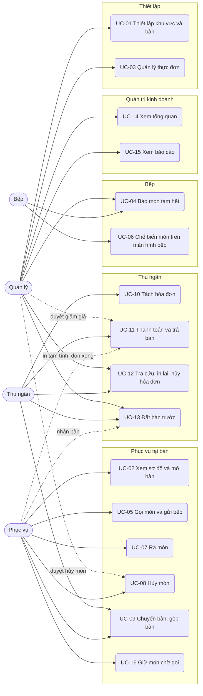
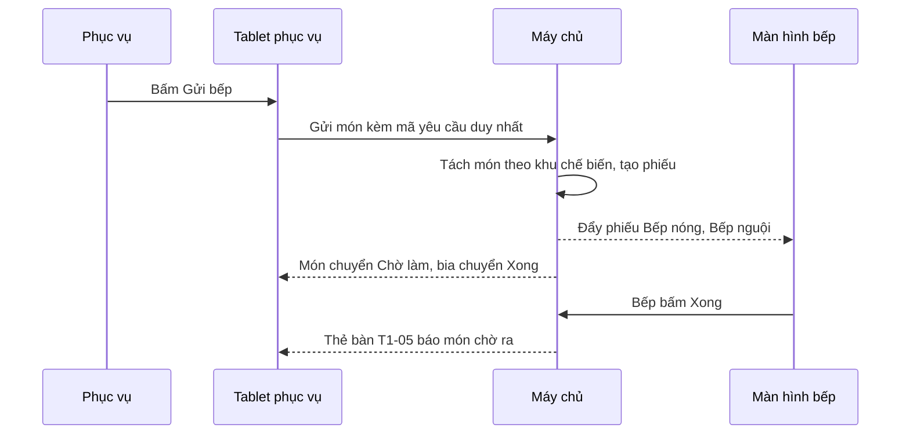

# Đặc tả use case — Quản lý Nhà hàng

> Use case phần nền (UC-SYS-01 đến UC-SYS-10): `ZDOCS/03-KIEN-TRUC/USE-CASE-NEN.md`.
> Mã FR, BR, SCR tham chiếu `02-SRS.md`.

---

## 1. Tác nhân

| Tác nhân | Mã vai trò | Use case chính |
| :--- | :--- | :--- |
| Phục vụ | `WAITER` | UC-02, UC-05, UC-07, UC-08, UC-09, UC-11 (in tạm tính, dọn xong), UC-13 (nhận bàn), UC-16 |
| Bếp | `KITCHEN` | UC-04, UC-06 |
| Thu ngân | `CASHIER` | UC-09, UC-10, UC-11, UC-12, UC-13 |
| Quản lý | `MANAGER` | UC-01, UC-03, UC-04, UC-08 (duyệt hủy), UC-11 (duyệt giảm giá), UC-12, UC-13, UC-14, UC-15 |
| Quản trị viên | `ADMIN` | Toàn bộ, cộng phần nền (cài đặt phí phục vụ, thuế suất ở UC-SYS-07) |

---

## 2. Sơ đồ use case

---

## 3. Danh sách use case

| Mã | Tên | Tác nhân chính | Module | Ưu tiên | FR |
| :--- | :--- | :--- | :--- | :---: | :--- |
| UC-01 | Thiết lập khu vực và bàn | Quản lý | Thiết lập | P1 | FR-02, FR-03 |
| UC-02 | Xem sơ đồ và mở bàn | Phục vụ | Phục vụ tại bàn | P1 | FR-04, FR-05 |
| UC-03 | Quản lý thực đơn | Quản lý | Thiết lập | P1 | FR-06, FR-07, FR-08 |
| UC-04 | Báo món tạm hết | Bếp, Quản lý | Bếp | P1 | FR-09, FR-10 |
| UC-05 | Gọi món và gửi bếp | Phục vụ | Phục vụ tại bàn | P1 | FR-11, FR-12, FR-13 |
| UC-06 | Chế biến món trên màn hình bếp | Bếp | Bếp | P1 | FR-15, FR-16, FR-17, FR-18 |
| UC-07 | Ra món | Phục vụ | Phục vụ tại bàn | P1 | FR-19 |
| UC-08 | Hủy món | Phục vụ | Phục vụ tại bàn | P1 | FR-20, FR-21 |
| UC-09 | Chuyển bàn, gộp bàn | Phục vụ, Thu ngân | Phục vụ tại bàn | P1 | FR-22, FR-23, FR-24 |
| UC-10 | Tách hóa đơn | Thu ngân | Thu ngân | P1 | FR-25, FR-26 |
| UC-11 | Thanh toán và trả bàn | Thu ngân | Thu ngân | P1 | FR-27, FR-28, FR-29, FR-30, FR-31 |
| UC-12 | Tra cứu, in lại, hủy hóa đơn | Thu ngân, Quản lý | Thu ngân | P2 | FR-33 |
| UC-13 | Đặt bàn trước | Thu ngân, Quản lý | Thu ngân | P2 | FR-34, FR-35, FR-36 |
| UC-14 | Xem tổng quan | Quản lý | Quản trị kinh doanh | P2 | FR-01 |
| UC-15 | Xem báo cáo | Quản lý | Quản trị kinh doanh | P2 | FR-37, FR-38, FR-39, FR-40 |
| UC-16 | Giữ món chờ gọi | Phục vụ | Phục vụ tại bàn | P3 | FR-14 |

FR-32 (cài đặt phí phục vụ, thuế suất, hạn mức giảm giá) thực hiện trong UC-SYS-07.

---

## 4. Đặc tả chi tiết

### UC-01: Thiết lập khu vực và bàn

| Mục | Nội dung |
| :--- | :--- |
| Tác nhân chính | Quản lý |
| Mô tả | Khai báo khu vực, bàn và sắp xếp sơ đồ giống mặt bằng thật của nhà hàng |
| Ưu tiên | P1 |
| Điều kiện kích hoạt | Nhà hàng mới dùng hệ thống, kê thêm bàn hoặc đổi bố trí |
| Tiền điều kiện | Có quyền `tables.update` |
| Hậu điều kiện | Sơ đồ bàn của phục vụ hiển thị bố trí mới ở lần tải kế tiếp |
| Yêu cầu liên quan | FR-02, FR-03, BR-28 |
| Màn hình | SCR-03 |

**Luồng chính (thêm bàn)**

1. Quản lý mở Sơ đồ bàn, bấm "Thiết lập"; hệ thống chuyển sang chế độ thiết lập, hiện lưới nền và các tab khu vực.
2. Quản lý chọn tab "Sân vườn", bấm "Thêm bàn".
3. Nhập mã bàn `SV-09`, sức chứa 6, chọn hình dạng tròn.
4. Kéo thẻ bàn tới vị trí mong muốn; hệ thống bắt vị trí theo ô lưới.
5. Bấm "Lưu sơ đồ"; hệ thống lưu và thoát chế độ thiết lập.

**Luồng thay thế**

- 2a. Quản lý khu vực: thêm khu vực (mã 2 ký tự, tên), đổi tên, kéo thả thứ tự tab, ẩn khu vực tạm không dùng (vd sân vườn mùa mưa).
- 4a. Sửa bàn: chọn bàn, đổi sức chứa, hình dạng hoặc chuyển sang khu vực khác.
- 4b. Ẩn bàn: bàn biến khỏi sơ đồ của phục vụ nhưng vẫn có trong báo cáo.

**Luồng ngoại lệ**

- E1. Mã bàn trùng: báo lỗi tại ô mã bàn.
- E2. Sức chứa ngoài khoảng 1–20: báo lỗi tại ô sức chứa.
- E3. Ẩn, xóa hoặc đổi khu vực của bàn đang có hóa đơn mở: hệ thống từ chối, báo "Bàn đang có khách" (BR-28).
- E4. Thoát chế độ thiết lập khi chưa lưu: hệ thống hỏi xác nhận bỏ thay đổi.

### UC-02: Xem sơ đồ và mở bàn

| Mục | Nội dung |
| :--- | :--- |
| Tác nhân chính | Phục vụ |
| Mô tả | Theo dõi tình trạng các bàn và mở bàn khi khách vào |
| Ưu tiên | P1 |
| Điều kiện kích hoạt | Khách vào nhà hàng, phục vụ dẫn khách tới bàn |
| Tiền điều kiện | Có quyền `tables.open`; bàn đang "Trống" hoặc "Đã đặt" |
| Hậu điều kiện | Bàn "Đang phục vụ"; hóa đơn mới mã `HD…` gắn với bàn và phục vụ |
| Yêu cầu liên quan | FR-04, FR-05, BR-01, BR-02, BR-03 |
| Màn hình | SCR-02, SCR-04 |

**Luồng chính**

1. Phục vụ đăng nhập; hệ thống mở Sơ đồ bàn ở tab khu vực đầu tiên, thanh đếm phía trên ghi số bàn theo từng trạng thái (Trống, Đã đặt, Đang phục vụ, Chờ thanh toán, Chờ dọn).
2. Phục vụ chạm bàn trống `T1-05`.
3. Hệ thống mở hộp "Mở bàn" có bàn phím số lớn, gợi ý số khách bằng sức chứa của bàn.
4. Phục vụ nhập 4, bấm "Mở bàn".
5. Hệ thống tạo hóa đơn, chuyển bàn sang "Đang phục vụ" và mở màn Gọi món của bàn.

**Luồng thay thế**

- 1a. Lọc: chạm một ô trên thanh đếm để chỉ hiện bàn có trạng thái đó.
- 2a. Chạm bàn đang phục vụ: mở thẳng màn Gọi món của bàn.
- 2b. Chạm bàn "Đã đặt": hệ thống hiện tên khách, giờ đến và hỏi "Nhận bàn cho khách đặt" (chuyển sang UC-13) hay "Mở cho khách khác" (có cảnh báo trùng giờ đặt).
- 2c. Chạm bàn "Chờ dọn": bấm "Dọn xong", bàn về "Trống".
- 5a. Đóng bàn mở nhầm: ở màn Gọi món, khi chưa gửi bếp món nào, bấm "Đóng bàn"; hóa đơn chuyển "Đã hủy" lý do "Mở nhầm", bàn về "Trống" (BR-03).

**Luồng ngoại lệ**

- E1. Số khách để trống, bằng 0 hoặc lớn hơn 50: báo lỗi, không mở bàn.
- E2. Số khách lớn hơn sức chứa: cảnh báo "Bàn 4 chỗ, đang mở cho 7 khách"; phục vụ xác nhận thì mở tiếp (BR-01).
- E3. Hai phục vụ cùng mở một bàn: người sau nhận thông báo "Bàn T1-05 vừa được mở bởi {tên}" và vào màn Gọi món của hóa đơn đã có, không tạo hóa đơn thứ hai.
- E4. Bàn đã gửi bếp món: nút "Đóng bàn" không hiển thị.

### UC-03: Quản lý thực đơn

| Mục | Nội dung |
| :--- | :--- |
| Tác nhân chính | Quản lý |
| Mô tả | Thêm, sửa, ẩn danh mục, món, ghi chú nhanh; khai báo khu chế biến và thời gian chuẩn của từng món |
| Ưu tiên | P1 |
| Điều kiện kích hoạt | Nhà hàng đổi món, đổi giá, thêm món theo mùa |
| Tiền điều kiện | Có quyền `menu-items.create` hoặc `menu-items.update` |
| Hậu điều kiện | Tablet phục vụ hiển thị thực đơn mới ở lần tải kế tiếp |
| Yêu cầu liên quan | FR-06, FR-07, FR-08, BR-04, BR-28 |
| Màn hình | SCR-11 |

**Luồng chính (thêm món theo trọng lượng)**

1. Quản lý mở Thực đơn, tab Món; hệ thống hiện danh sách món theo danh mục kèm ảnh, giá, khu chế biến, trạng thái.
2. Bấm "Thêm món", nhập mã `M061`, tên "Tôm sú nướng muối ớt", chọn danh mục Hải sản, tải ảnh, nhập mô tả.
3. Chọn cách tính "Theo trọng lượng", đơn vị "kg", nhập đơn giá 690.000 ₫.
4. Chọn khu chế biến "Bếp nóng", nhập thời gian chế biến chuẩn 20 phút.
5. Bấm "Lưu"; món xuất hiện trong danh sách, giá hiển thị "690.000 ₫/kg".

**Luồng thay thế**

- 1a. Tab Danh mục: thêm, đổi tên, kéo thả thứ tự, ẩn danh mục.
- 1b. Tab Ghi chú nhanh: thêm, sửa, sắp xếp ghi chú (FR-08).
- 3a. Món theo suất: chọn đơn vị (đĩa, phần, nồi, ly, lon, chai) và đơn giá; phục vụ gọi theo số lượng nguyên.
- 5a. Sửa giá món đang bán: hóa đơn đang mở giữ giá lúc gọi, món gọi sau dùng giá mới.
- 5b. Ẩn món: món biến khỏi tablet phục vụ nhưng vẫn có trong báo cáo.

**Luồng ngoại lệ**

- E1. Mã món trùng: báo lỗi tại ô mã.
- E2. Đơn giá không phải bội số 1.000 ₫ hoặc bằng 0; thời gian chuẩn ngoài 1–120 phút: báo lỗi, không lưu.
- E3. Xóa món đã từng được gọi: hệ thống từ chối, gợi ý dùng "Ẩn" (BR-28).

### UC-04: Báo món tạm hết

| Mục | Nội dung |
| :--- | :--- |
| Tác nhân chính | Bếp |
| Tác nhân phụ | Quản lý |
| Mô tả | Báo món hết nguyên liệu để phục vụ không nhận gọi nữa, báo hết món đang chờ trên phiếu |
| Ưu tiên | P1 |
| Điều kiện kích hoạt | Bếp hết nguyên liệu giữa ca, vd hết cá chẽm |
| Tiền điều kiện | Có quyền `menu-items.availability` |
| Hậu điều kiện | Món tạm hết hiển thị mờ, không gọi được trên mọi tablet phục vụ |
| Yêu cầu liên quan | FR-09, FR-10, BR-13, BR-14 |
| Màn hình | SCR-10, SCR-11 |

**Luồng chính**

1. Trên màn hình bếp, bếp bấm "Thực đơn" ở thanh công cụ, tìm "Cá chẽm hấp Hồng Kông".
2. Bấm công tắc "Còn bán" sang "Tạm hết".
3. Hệ thống lưu; trong 3 giây tablet phục vụ hiển thị món mờ, nhãn "Tạm hết".

**Luồng thay thế**

- 1a. Báo hết món đang chờ: bếp nhấn giữ dòng món ở trạng thái "Chờ làm" trên phiếu, chọn "Hết món". Món chuyển "Đã hủy" lý do "Hết món", tự chuyển "Tạm hết" trên thực đơn; tablet của phục vụ phụ trách bàn hiện thông báo "T1-05: Cá chẽm hấp Hồng Kông đã hết, mời khách đổi món" (BR-14).
- 2a. Bán lại: bật công tắc về "Còn bán".
- 1b. Quản lý thao tác ở màn Thực đơn bằng cùng công tắc.

**Luồng ngoại lệ**

- E1. Món đang "Đang làm" hoặc đã "Xong": không có lựa chọn "Hết món"; muốn hủy phải qua UC-08 có quản lý duyệt.
- E2. Phục vụ đang có món đó ở phần "Chưa gửi bếp": khi bấm Gửi bếp, hệ thống gửi các món còn lại, giữ dòng tạm hết ở phần "Chưa gửi bếp" với nhãn đỏ "Tạm hết".

### UC-05: Gọi món và gửi bếp

| Mục | Nội dung |
| :--- | :--- |
| Tác nhân chính | Phục vụ |
| Mô tả | Ghi món khách gọi tại bàn và gửi thẳng xuống đúng khu chế biến |
| Ưu tiên | P1 |
| Điều kiện kích hoạt | Khách gọi món hoặc gọi thêm |
| Tiền điều kiện | Bàn "Đang phục vụ" hoặc "Chờ thanh toán"; có quyền `orders.create`; hóa đơn chưa có lượt thu (BR-22) |
| Hậu điều kiện | Món ở trạng thái "Chờ làm" trên màn hình bếp; món không qua bếp ở trạng thái "Xong" |
| Yêu cầu liên quan | FR-11, FR-12, FR-13, BR-04, BR-05, BR-09, BR-21 |
| Màn hình | SCR-04, SCR-10 |

**Luồng chính**

1. Phục vụ mở màn Gọi món của bàn T1-05; bên trái là thực đơn dạng lưới theo danh mục, bên phải là danh sách món của bàn.
2. Chạm món "Gỏi ngó sen tôm thịt"; món vào phần "Chưa gửi bếp" với số lượng 1.
3. Chạm dòng để mở hộp chi tiết: sửa số lượng, chọn ghi chú nhanh "Ít cay", nhập ghi chú tự do, bật "Gấp".
4. Chạm món theo trọng lượng "Cá chẽm hấp Hồng Kông"; hệ thống mở bàn phím số yêu cầu nhập số kg. Phục vụ cân cá cho khách xem rồi nhập 1,2; thành tiền 540.000 ₫ (BR-04).
5. Lặp lại cho các món khác; tạm tính tiền món cập nhật ngay.
6. Bấm "Gửi bếp (n món)".
7. Hệ thống tạo phiếu bếp theo khu chế biến (BR-09), chuyển món sang phần "Đã gửi bếp" với trạng thái "Chờ làm", món không qua bếp chuyển "Xong"; hiện thông báo "Đã gửi 2 phiếu: Bếp nóng, Bếp nguội".

**Luồng thay thế**

- 2a. Chạm lại món đã có ở phần chưa gửi, cùng ghi chú: hệ thống cộng số lượng vào dòng cũ.
- 3a. Xóa món chưa gửi: vuốt dòng sang trái hoặc bấm biểu tượng xóa, không cần lý do.
- 6a. Gọi thêm: lặp bước 2–7; phiếu mới ghi "Lần 2", "Lần 3"…
- 6b. Bàn đang "Chờ thanh toán": gửi thêm món thì bàn về "Đang phục vụ", hệ thống báo phiếu tạm tính đã in hết hiệu lực (BR-21).

**Luồng ngoại lệ**

- E1. Món tạm hết: thẻ món mờ, chạm không thêm được.
- E2. Số lượng ngoài giới hạn (theo suất 1–99, theo trọng lượng 0,1–20 kg): báo lỗi tại ô nhập.
- E3. Mất kết nối khi gửi: món giữ ở phần "Chưa gửi bếp", báo "Chưa gửi được, thử lại"; gửi lại không tạo trùng phiếu (NFR-05).
- E4. Có món vừa chuyển tạm hết trong phần chưa gửi: xử lý như UC-04 E2.

### UC-06: Chế biến món trên màn hình bếp

| Mục | Nội dung |
| :--- | :--- |
| Tác nhân chính | Bếp |
| Mô tả | Nhận phiếu theo thời gian thực, làm món theo thứ tự ưu tiên, báo xong cho phục vụ |
| Ưu tiên | P1 |
| Điều kiện kích hoạt | Phục vụ gửi bếp |
| Tiền điều kiện | Có quyền `kitchen-tickets.view`, `kitchen-tickets.update` |
| Hậu điều kiện | Món "Xong" hiện trong danh sách "Món chờ ra" của phục vụ |
| Yêu cầu liên quan | FR-15, FR-16, FR-17, FR-18, BR-10, BR-11, BR-12, BR-13 |
| Màn hình | SCR-10 |

**Luồng chính**

1. Bếp đăng nhập trên màn hình bếp; hệ thống mở Màn hình bếp với khu chế biến đã chọn lần trước (vd Bếp nóng).
2. Hệ thống hiển thị phiếu dạng thẻ theo BR-12; mỗi thẻ có mã bàn, lần gọi, tên phục vụ, giờ gửi, đồng hồ thời gian chờ, món, số lượng, ghi chú tô đậm, nhãn "GẤP" nếu có.
3. Khi có phiếu mới, thẻ xuất hiện đúng vị trí theo BR-12, viền nhấp nháy 5 giây, phát âm báo.
4. Đầu bếp chạm một món, chọn "Bắt đầu"; món chuyển "Đang làm".
5. Làm xong, chạm "Xong"; món gạch xanh. Khi mọi món trên phiếu "Xong", thẻ chuyển sang danh sách "Đã xong" (BR-10).
6. Hệ thống tính lại màu món và màu phiếu theo BR-11 mỗi 15 giây.

**Luồng thay thế**

- 2a. Đổi khu chế biến hoặc chọn "Tất cả".
- 2b. Chế độ tổng hợp: bảng "Món – số lượng đang chờ" (vd Rau muống xào tỏi: 5 đĩa); chạm một món để xem các bàn đang chờ món đó (FR-18).
- 4a. Bấm "Xong cả phiếu" mà không cần bấm "Bắt đầu" từng món.
- 5a. Hoàn tác: trong danh sách "Đã xong", chọn phiếu, bấm "Hoàn tác" ở món chưa ra; món về "Đang làm", phiếu trở lại màn chính.
- 5b. Món bị hủy khi phiếu đang hiển thị: dòng món gạch ngang, nhãn "ĐÃ HỦY", viền thẻ đỏ tới khi bếp bấm "Đã biết" (BR-13).

**Luồng ngoại lệ**

- E1. Mất kết nối: thanh trên cùng chuyển đỏ "Mất kết nối, đang thử lại"; có mạng lại thì tự tải lại danh sách phiếu.
- E2. Hoàn tác món đã ra: hệ thống từ chối, báo "Món đã ra cho khách".

### UC-07: Ra món

| Mục | Nội dung |
| :--- | :--- |
| Tác nhân chính | Phục vụ |
| Mô tả | Biết ngay món nào xong để mang ra bàn, ghi nhận món đã ra |
| Ưu tiên | P1 |
| Điều kiện kích hoạt | Bếp báo xong hoặc gửi món không qua bếp |
| Tiền điều kiện | Có món ở trạng thái "Xong" |
| Hậu điều kiện | Món chuyển "Đã phục vụ"; huy hiệu món chờ ra trên thẻ bàn giảm tương ứng |
| Yêu cầu liên quan | FR-19, BR-10 |
| Màn hình | SCR-02, SCR-04 |

**Luồng chính**

1. Bếp báo xong; tablet phục vụ phát âm báo, thẻ bàn T1-05 trên sơ đồ hiện huy hiệu số dòng món chờ ra.
2. Phục vụ bấm biểu tượng chuông để mở danh sách "Món chờ ra", gom theo bàn, món xong sớm xếp trước, mặc định lọc bàn của mình.
3. Mang món ra bàn, bấm "Đã ra" ở từng dòng hoặc "Ra hết" ở bàn.
4. Món chuyển "Đã phục vụ", huy hiệu giảm.

**Luồng thay thế**

- 2a. Từ màn Gọi món của bàn: dòng món "Xong" có nút "Đã ra".
- 2b. Bỏ lọc "Bàn của tôi" để ra món giúp đồng nghiệp.

**Luồng ngoại lệ**

- E1. Bấm nhầm "Đã ra": thông báo nổi có nút "Hoàn tác" trong 10 giây; bấm thì món về "Xong".
- E2. Món bị hủy trong lúc đang mang ra: dòng biến khỏi danh sách, tablet hiện thông báo món đã hủy.

### UC-08: Hủy món

| Mục | Nội dung |
| :--- | :--- |
| Tác nhân chính | Phục vụ |
| Tác nhân phụ | Quản lý (duyệt hủy món đã chế biến) |
| Mô tả | Bỏ món khách không lấy, có lý do; món bếp đã làm phải có quản lý duyệt |
| Ưu tiên | P1 |
| Điều kiện kích hoạt | Khách đổi ý, gọi nhầm, chờ lâu không muốn lấy |
| Tiền điều kiện | Có quyền `order-items.cancel`; hóa đơn chưa có lượt thu (BR-22) |
| Hậu điều kiện | Món "Đã hủy", không tính tiền, có trong báo cáo món hủy |
| Yêu cầu liên quan | FR-20, FR-21, BR-13, BR-22 |
| Màn hình | SCR-04, SCR-07, SCR-10 |

**Luồng chính (món chờ làm)**

1. Ở màn Gọi món, phục vụ chạm món ở phần "Đã gửi bếp", chọn "Hủy món".
2. Chọn số lượng hủy (mặc định toàn bộ) và lý do: Khách đổi ý, Gọi nhầm, Chờ lâu, Khác kèm ghi chú.
3. Hệ thống kiểm tra trạng thái món theo BR-13; món "Chờ làm" được hủy ngay.
4. Món chuyển "Đã hủy", tạm tính giảm; màn hình bếp hiện dòng gạch ngang, nhãn "ĐÃ HỦY".

**Luồng thay thế**

- 2a. Hủy một phần: hủy 2 trong 6 lon bia; dòng tách thành 4 lon còn hiệu lực và 2 lon "Đã hủy".
- 3a. Món "Đang làm", "Xong" hoặc "Đã phục vụ": hệ thống mở hộp "Quản lý xác nhận"; quản lý nhập tên đăng nhập và mật khẩu. Tài khoản có quyền `order-items.void-approve` thì món được hủy, ghi người duyệt.
- 1a. Món "Chưa gửi": xóa thẳng ở UC-05 bước 3a, không lưu lịch sử.

**Luồng ngoại lệ**

- E1. Chưa chọn lý do: nút "Xác nhận hủy" bị khóa.
- E2. Tài khoản xác nhận không có quyền hoặc sai mật khẩu: từ chối, món giữ nguyên.
- E3. Hóa đơn đã có lượt thu: nút "Hủy món" ẩn, ghi chú "Hóa đơn đang thu tiền".

### UC-09: Chuyển bàn, gộp bàn

| Mục | Nội dung |
| :--- | :--- |
| Tác nhân chính | Phục vụ |
| Tác nhân phụ | Thu ngân |
| Mô tả | Đổi chỗ cho khách, gộp nhiều bàn để thanh toán chung, chuyển món giữa hai bàn |
| Ưu tiên | P1 |
| Điều kiện kích hoạt | Khách xin đổi chỗ (trời mưa, ồn), nhóm khách ngồi hai bàn muốn trả chung |
| Tiền điều kiện | Có quyền `tables.transfer`; hóa đơn chưa có lượt thu (BR-22) |
| Hậu điều kiện | Hóa đơn gắn bàn mới hoặc gộp vào bàn chính; bếp thấy mã bàn mới |
| Yêu cầu liên quan | FR-22, FR-23, FR-24, BR-15, BR-16, BR-17, BR-22 |
| Màn hình | SCR-04, SCR-05 |

**Luồng chính (chuyển bàn)**

1. Ở màn Gọi món của bàn SV-01, phục vụ bấm "Chuyển bàn".
2. Hệ thống hiện sơ đồ thu nhỏ; chỉ bàn "Trống" và "Đã đặt" chọn được, các bàn khác mờ.
3. Phục vụ chọn T1-10, bấm "Chuyển".
4. Hệ thống gắn hóa đơn sang T1-10 (BR-15): T1-10 "Đang phục vụ", SV-01 "Trống"; phiếu bếp đang chờ hiện "T1-10 (từ SV-01)".

**Luồng thay thế**

- 1a. Gộp bàn: ở bàn chính T1-05 bấm "Gộp bàn", chọn T1-06 (chỉ bàn "Đang phục vụ", "Chờ thanh toán" chọn được), xác nhận. Món và số khách của T1-06 chuyển sang T1-05; T1-06 hiện "Đã gộp → T1-05" (BR-16).
- 1b. Chuyển món: chạm món, chọn "Chuyển món", chọn số lượng và bàn đích đang phục vụ; món giữ trạng thái chế biến (BR-17).
- 3a. Chọn bàn "Đã đặt": cảnh báo "Bàn có khách đặt lúc 19:00", phục vụ xác nhận để tiếp tục.

**Luồng ngoại lệ**

- E1. Hóa đơn đã có lượt thu: nút "Chuyển bàn", "Gộp bàn" bị khóa (BR-22).
- E2. Chạm vào bàn phụ đã gộp: hệ thống mở màn Gọi món của bàn chính.

### UC-10: Tách hóa đơn

| Mục | Nội dung |
| :--- | :--- |
| Tác nhân chính | Thu ngân |
| Mô tả | Tách món thành nhiều hóa đơn hoặc chia đều số tiền cho nhiều người |
| Ưu tiên | P1 |
| Điều kiện kích hoạt | Khách muốn trả riêng phần mình hoặc chia đều |
| Tiền điều kiện | Có quyền `orders.split`; hóa đơn không còn món "Chưa gửi" (BR-21), chưa có lượt thu (BR-22) |
| Hậu điều kiện | Bàn có nhiều hóa đơn, mỗi hóa đơn tính phí phục vụ, thuế, làm tròn riêng; hoặc hóa đơn có N phần cần thu |
| Yêu cầu liên quan | FR-25, FR-26, BR-06, BR-07, BR-18, BR-19, BR-21, BR-22 |
| Màn hình | SCR-06, SCR-08 |

**Luồng chính (tách theo món)**

1. Thu ngân mở bàn T1-05, bấm "Tách hóa đơn".
2. Hệ thống hiện hai cột: trái là hóa đơn gốc, phải là hóa đơn mới đang trống.
3. Thu ngân chạm món để chuyển sang cột phải; dòng có số lượng lớn hơn 1 hiện nút +/− để chọn số lượng chuyển.
4. Mỗi cột cập nhật tiền món, phí phục vụ, thuế GTGT, làm tròn, tổng thanh toán (BR-06, BR-07).
5. Bấm "Xác nhận tách"; hệ thống tạo hóa đơn mới mã mới, cùng bàn; màn của bàn hiện các hóa đơn dạng tab.
6. Thu ngân thanh toán từng hóa đơn theo UC-11.

**Luồng thay thế**

- 2a. Bấm "Thêm hóa đơn" để có cột thứ ba (tối đa 10 hóa đơn mỗi bàn).
- 1a. Chia đều: chọn "Chia đều", nhập số người N; hệ thống hiện N phần theo BR-19. Thu ngân thu từng phần với phương thức riêng; đủ N phần thì hóa đơn "Đã thanh toán".
- 1b. Hủy chia đều khi chưa thu phần nào: hóa đơn trở về một khoản thu duy nhất.

**Luồng ngoại lệ**

- E1. Chuyển hết món sang hóa đơn mới: báo "Hóa đơn gốc phải còn ít nhất 1 món", không cho xác nhận.
- E2. Món theo trọng lượng: chỉ chuyển nguyên dòng, không có nút +/−.
- E3. Hóa đơn đang có giảm giá: cảnh báo "Giảm giá sẽ bị gỡ, cần áp lại sau khi tách".
- E4. N ngoài khoảng 2–20: báo lỗi.
- E5. Đã thu một phần khi chia đều: thêm món, hủy món, giảm giá, tách, đổi số phần đều bị chặn (BR-22).

### UC-11: Thanh toán và trả bàn

| Mục | Nội dung |
| :--- | :--- |
| Tác nhân chính | Thu ngân |
| Tác nhân phụ | Phục vụ (in tạm tính, dọn xong), Quản lý (duyệt giảm giá vượt mức) |
| Mô tả | In tạm tính, tính phí phục vụ và thuế, thu tiền một hoặc nhiều phương thức, in hóa đơn, trả bàn |
| Ưu tiên | P1 |
| Điều kiện kích hoạt | Khách gọi tính tiền |
| Tiền điều kiện | Hóa đơn có ít nhất một món đã gửi bếp, không còn món "Chưa gửi" (BR-21); có quyền `orders.checkout` |
| Hậu điều kiện | Hóa đơn "Đã thanh toán", bàn "Chờ dọn" rồi "Trống" sau khi dọn |
| Yêu cầu liên quan | FR-27, FR-28, FR-29, FR-30, FR-31, BR-05 đến BR-08, BR-20, BR-21, BR-25 |
| Màn hình | SCR-04, SCR-07, SCR-08, SCR-09 |

**Luồng chính**

1. Khách gọi tính tiền; phục vụ bấm "In tạm tính" ở màn Gọi món. Hệ thống mở bản in khổ 80 mm có dòng "PHIẾU TẠM TÍNH – chưa phải hóa đơn"; bàn chuyển "Chờ thanh toán".
2. Thu ngân chạm bàn trên sơ đồ, bấm "Thanh toán"; hệ thống mở màn Thanh toán gồm danh sách món, tiền món, giảm giá, phí phục vụ 5%, thuế GTGT 8%, làm tròn, tổng thanh toán, số còn phải thu.
3. Thu ngân chọn phương thức:
   - Tiền mặt: nhập tiền khách đưa hoặc bấm nút nhanh (Đủ tiền, 500.000, 1.000.000, 2.000.000); hệ thống hiện tiền thối.
   - Chuyển khoản: hệ thống hiện QR giả lập có số tiền và nội dung là mã hóa đơn; khách quét và chuyển, thu ngân bấm "Đã nhận tiền".
   - Thẻ: nhập 4 số cuối thẻ, bấm "Đã quẹt thẻ" (giả lập máy POS ngân hàng).
4. Hệ thống ghi lượt thu, cập nhật số còn phải thu.
5. Số còn phải thu bằng 0: hệ thống chốt hóa đơn "Đã thanh toán", mở bản in hóa đơn, bàn chuyển "Chờ dọn".
6. Phục vụ dọn bàn, bấm "Dọn xong" trên sơ đồ; bàn về "Trống".

**Luồng thay thế**

- 1a. Thu ngân bỏ qua tạm tính, thanh toán thẳng khi bàn đang "Đang phục vụ".
- 2a. Giảm giá: bấm "Giảm giá", chọn phần trăm hoặc số tiền, chọn lý do; vượt 10% tiền món thì mở hộp Quản lý xác nhận, quản lý nhập tài khoản có quyền `orders.discount-override` (BR-08).
- 2b. Có tiền cọc đặt bàn: hệ thống tự tạo lượt thu "Tiền cọc", số còn phải thu giảm tương ứng (BR-25).
- 3a. Kết hợp: thu chuyển khoản 1.000.000 ₫ trước, phần còn lại thu tiền mặt.

**Luồng ngoại lệ**

- E1. Còn món "Chưa gửi": nút "In tạm tính", "Thanh toán" bị khóa, báo "Còn {n} món chưa gửi bếp".
- E2. Còn món bếp chưa xong: cảnh báo "Còn {n} món bếp chưa xong"; thu ngân xác nhận tiếp tục, hoặc hủy món theo UC-08.
- E3. Chuyển khoản hoặc thẻ lớn hơn số còn phải thu: báo lỗi, không ghi lượt thu.
- E4. Tiền mặt nhỏ hơn số còn phải thu: hệ thống hỏi "Thu một phần {số tiền}?"; đồng ý thì ghi lượt thu, hóa đơn chuyển "Đang thu tiền" (BR-20, BR-22).
- E5. Mất kết nối khi bấm thu: báo "Chưa ghi được lượt thu, thử lại"; bấm lại không tạo trùng (NFR-05).

### UC-12: Tra cứu, in lại, hủy hóa đơn

| Mục | Nội dung |
| :--- | :--- |
| Tác nhân chính | Thu ngân, Quản lý |
| Mô tả | Tìm hóa đơn đã thanh toán, in lại, hủy hóa đơn thu nhầm trong ngày |
| Ưu tiên | P2 |
| Yêu cầu liên quan | FR-33, BR-23 |
| Màn hình | SCR-12, SCR-09 |

**Luồng chính**

1. Mở Danh sách hóa đơn; mặc định hiện hóa đơn hôm nay, mới nhất trước.
2. Tìm theo mã hoặc lọc theo bàn, khoảng ngày, trạng thái, phương thức.
3. Chọn hóa đơn để xem chi tiết: món, món hủy, các lượt thu, người phục vụ, thu ngân.
4. Bấm "In lại"; bản in có dòng "IN LẠI".
5. Quản lý bấm "Hủy hóa đơn" với hóa đơn thanh toán trong ngày, nhập lý do, xác nhận; hóa đơn chuyển "Đã hủy", không tính doanh thu.

### UC-13: Đặt bàn trước

| Mục | Nội dung |
| :--- | :--- |
| Tác nhân chính | Thu ngân, Quản lý |
| Tác nhân phụ | Phục vụ (nhận bàn) |
| Mô tả | Ghi nhận khách đặt bàn qua điện thoại, giữ bàn, nhận bàn khi khách đến |
| Ưu tiên | P2 |
| Yêu cầu liên quan | FR-34, FR-35, FR-36, BR-24, BR-25 |
| Màn hình | SCR-13, SCR-02 |

**Luồng chính**

1. Thu ngân mở Đặt bàn; hệ thống hiện dòng thời gian hôm nay, mỗi hàng một bàn, mỗi khối một đặt bàn.
2. Bấm "Thêm đặt bàn", nhập tên khách, số điện thoại, giờ đến, số khách, ghi chú, tiền cọc; hệ thống gợi ý bàn trống đủ chỗ trong khung 120 phút.
3. Chọn bàn, bấm "Lưu"; hệ thống tạo đặt bàn mã `DB…` trạng thái "Chờ đến".
4. Từ 60 phút trước giờ đến, bàn hiện "Đã đặt" trên sơ đồ.
5. Khách đến; phục vụ chạm bàn, chọn "Nhận bàn"; hệ thống mở bàn với số khách, ghi chú, tiền cọc đã đặt; đặt bàn chuyển "Đã nhận bàn".

### UC-14: Xem tổng quan

| Mục | Nội dung |
| :--- | :--- |
| Tác nhân chính | Quản lý |
| Mô tả | Nắm nhanh tình hình phục vụ và doanh thu hôm nay |
| Ưu tiên | P2 |
| Yêu cầu liên quan | FR-01, BR-11, BR-26 |
| Màn hình | SCR-01 |

**Luồng chính**

1. Quản lý đăng nhập; hệ thống mở Tổng quan.
2. Hàng thẻ số: bàn đang phục vụ / tổng bàn, khách đang ngồi, doanh thu thuần, số hóa đơn, doanh thu trung bình mỗi khách.
3. Hàng thẻ bếp: món đang chờ, món trễ (màu đỏ), thời gian ra món trung bình hôm nay.
4. Bảng 5 bàn ngồi lâu nhất; chạm một bàn để mở màn Gọi món của bàn đó.

### UC-15: Xem báo cáo

| Mục | Nội dung |
| :--- | :--- |
| Tác nhân chính | Quản lý |
| Mô tả | Phân tích doanh thu, món bán chạy, món hủy, tốc độ bếp, hiệu quả bàn |
| Ưu tiên | P2 |
| Yêu cầu liên quan | FR-37, FR-38, FR-39, FR-40, BR-26, BR-27 |
| Màn hình | SCR-14 |

**Luồng chính**

1. Quản lý mở Báo cáo; mặc định tab Doanh thu, khoảng 30 ngày gần nhất.
2. Hệ thống hiện biểu đồ doanh thu thuần theo ngày, đường kỳ trước làm nền, bảng số liệu có phí phục vụ, thuế GTGT bên dưới.
3. Quản lý đổi khoảng ngày; số liệu cập nhật.
4. Chuyển sang tab Món bán chạy, Món hủy, Vận hành bếp, Khu vực và bàn để xem các báo cáo khác.
