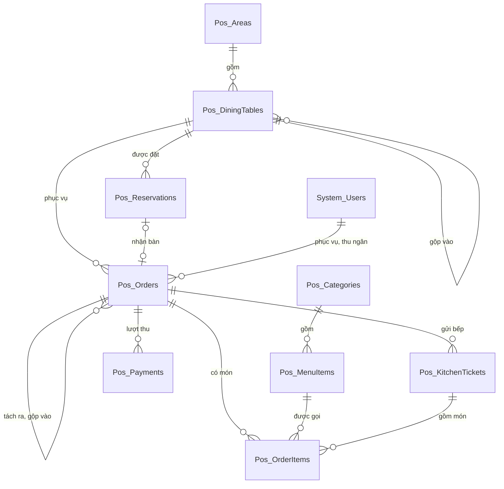

# Thiết kế CSDL — Quản lý Nhà hàng

> Database: `WebDemo_FnbQuanLyNhaHang`.
> Quy ước chung và nhóm bảng nền `System_*` (tài khoản, vai trò, quyền, cài đặt, nhật ký): xem `ZDOCS/03-KIEN-TRUC/THIET-KE-CSDL-NEN.md`.
> File này chỉ mô tả **bảng nghiệp vụ riêng của dự án**. Area: `Pos` (sơ đồ bàn, thực đơn, gọi món, bếp, thanh toán, đặt bàn).
> Mã FR, BR, TC tham chiếu `02-SRS.md` và `05-KICH-BAN-KIEM-THU.md`. Hợp đồng API, công thức tính tiền, quy ước FE: `07-DANH-SACH-API.md`.

---

## 1. Sơ đồ



`Pos_QuickNotes` (ghi chú nhanh) đứng riêng, không có khóa ngoại: món gọi chụp nội dung ghi chú dạng chữ.

---

## 2. Danh sách bảng

| Bảng | Area | Mô tả | Xóa | Dữ liệu mẫu |
| :--- | :--- | :--- | :--- | :---: |
| `Pos_Areas` | Pos | Khu vực | Mềm, chặn khi còn bàn | 3 |
| `Pos_DiningTables` | Pos | Bàn, vị trí trên sơ đồ, trạng thái phục vụ | Mềm, chặn khi đang có khách (BR-28) | 30 |
| `Pos_Categories` | Pos | Danh mục món | Mềm, chặn khi còn món | 10 |
| `Pos_MenuItems` | Pos | Món | Mềm, chặn khi đã từng gọi (BR-28) | 60 |
| `Pos_QuickNotes` | Pos | Ghi chú nhanh | Cứng | 10 |
| `Pos_Orders` | Pos | Hóa đơn của bàn (gồm hóa đơn tách, hóa đơn bàn phụ đã gộp) | Không xóa | 2.523 |
| `Pos_OrderItems` | Pos | Món gọi (chụp tên, giá lúc gọi) | Không xóa, trừ món "Chưa gửi" xóa cứng (BR-13) | 17.165 |
| `Pos_KitchenTickets` | Pos | Phiếu bếp: món của một lần gửi cho một khu chế biến | Không xóa | 7.306 |
| `Pos_Payments` | Pos | Lượt thu (gồm lượt "Tiền cọc") | Không xóa | 2.621 |
| `Pos_Reservations` | Pos | Đặt bàn | Không xóa, hủy bằng trạng thái | 50 |

Số dòng hóa đơn, món gọi, phiếu bếp, lượt thu là số seeder suy ra từ `FE/src/mock/seed/demo-data.json` (§5); số chính xác ghi ở §5.7.

---

## 3. Quy ước chung của dự án

- Mọi bảng có cột chung `Id`, `CreatedAt`, `CreatedBy`, `UpdatedAt`, `UpdatedBy` theo `THIET-KE-CSDL-NEN.md` §1; bảng xóa mềm có thêm `IsDeleted`. Cột unique của bảng xóa mềm dùng index lọc bản ghi chưa xóa (`.IsUnique().WhereNotDeleted()`).
- Tiền `numeric(18,2)`. Giá món, giảm giá số tiền, tiền cọc là bội số 1.000 ₫; phí phục vụ, thuế tính tới 1 ₫ (BR-06). Số lượng món `numeric(18,3)`: món theo suất là số nguyên 1–99, món theo trọng lượng là số kg 0,1–20, bước 0,1 (BR-04). Tỉ lệ phí phục vụ, thuế suất là số nguyên phần trăm, lưu `integer`.
- Thời gian lưu UTC. "Ngày" trong mã chứng từ, số phiếu bếp, báo cáo, giờ mở cửa tính theo giờ Việt Nam (`VietnamTime`).
- Enum lưu `integer`, API trả chuỗi PascalCase không dấu (cùng tên với enum C#). Bảng tra giá trị ở từng bảng bên dưới; FE dùng chung bảng tra trong `07` §2.
- Người thao tác được chụp vào hóa đơn, món, phiếu (`…Id` + `…Name` là họ tên, `…Username` là tên đăng nhập) để báo cáo không phụ thuộc tài khoản. Người duyệt (hủy món, giảm giá) chỉ lưu tên đăng nhập, đúng như TC-24, TC-38, TC-44 (`quanly`).
- **Khóa lạc quan** (NFR-04): `Pos_Orders.Version` và `Pos_DiningTables.Version` là concurrency token (`IsConcurrencyToken()`), service tăng 1 ở mỗi thay đổi (quy tắc tăng ở `07` §3.6). Lỗi tranh chấp đổi thành 409 "Bàn vừa được cập nhật, đang tải lại".
- **Chống trùng** (NFR-05): mở bàn, nhận bàn có `Pos_Orders.ClientRequestId`; gửi bếp có `Pos_OrderItems.SendRequestId`; thu tiền có `Pos_Payments.ClientRequestId`. Gửi lại cùng mã trả kết quả cũ (`07` §3.7).
- Mã chứng từ sinh trong service, trong transaction (SRS §5.3): `HD` + `yyMMdd` + 4 số thứ tự trong ngày mở hóa đơn; phiếu bếp `#` + 3 số, đánh lại từ `#001` mỗi ngày; `DB` + `yyMMdd` + 3 số thứ tự trong ngày tạo đặt bàn. Trùng mã do hai request cùng lúc thì index unique báo lỗi, service thử lại một lần.
- Hóa đơn, món đã gửi, phiếu bếp, lượt thu, đặt bàn **không bao giờ xóa**, chỉ đổi trạng thái. Đặt lại dữ liệu demo xóa cứng toàn bộ bảng `Pos_*` (bảng con trước) rồi nạp lại.
- Cài đặt dùng chung lưu ở `System_Settings` (giá trị mẫu trong `FE/src/mock/seed/project.json`):

| Khóa | Nhóm | Giá trị mẫu | Ghi chú |
| :--- | :--- | :--- | :--- |
| `Store.Name`, `Store.Address`, `Store.Phone`, `Store.TaxCode`, `Store.ReceiptFooter` | Nhà hàng | Nhà hàng Sen Quê… | In trên phiếu tạm tính, hóa đơn |
| `Store.BankBin`, `Store.BankAccount`, `Store.BankAccountName` | Nhà hàng | `970436`, `0000000000` | QR chuyển khoản giả lập |
| `Store.OpenTime`, `Store.CloseTime` | Nhà hàng | `10:00`, `22:00` | Giờ mở cửa cho đặt bàn (BR-24) |
| `Billing.ServiceChargeRate` | Tính tiền | `5` | Số nguyên 0–15 (FR-32) |
| `Billing.VatRate` | Tính tiền | `8` | Một trong 0, 5, 8, 10 |
| `Billing.CashierDiscountLimit` | Tính tiền | `10` | Phần trăm tiền món thu ngân tự giảm (BR-08), số nguyên 0–100 |

  Các con số cố định khác là hằng số trong code (`PosRules`, BE và FE cùng giá trị): bàn hiện "Đã đặt" từ 60 phút trước giờ đến, giữ bàn 120 phút, nhãn "Trễ" sau 15 phút, "Không đến" sau 30 phút, đặt trước tối thiểu 30 phút (BR-24); tối đa 10 hóa đơn mỗi bàn (BR-18); chia đều 2–20 (BR-19); tiền cọc tối đa 5.000.000 ₫ (BR-25); token quản lý xác nhận sống 5 phút; hoàn tác "Đã ra" trong 60 giây phía máy chủ (FE hiện nút 10 giây).
- Ảnh món mẫu: `/seed/menu/{maMon}.webp` (vd `/seed/menu/M014.webp`), FE phục vụ từ `FE/public/seed/menu/`; seed chỉ ghi tên file ở trường `image`, seeder và FE mock ghép thành đường dẫn. Ảnh tải lên qua giao diện lưu `/uploads/menu/{yyyy}/{MM}/{guid}.{ext}` theo `IFileStorage` nền. Món chưa có ảnh (`imageUrl` null) FE hiện ô màu theo danh mục kèm chữ viết tắt.

---

## 4. Mô tả bảng

### `Pos_Areas`: khu vực

| Cột | Kiểu | Ràng buộc | Ghi chú |
| :--- | :--- | :--- | :--- |
| `Code` | `varchar(2)` | unique trong bản ghi chưa xóa, `^[A-Z0-9]{2}$` | `T1`, `T2`, `SV` (SRS §5.3) |
| `Name` | `varchar(50)` | bắt buộc | |
| `SortOrder` | `integer` | | Thứ tự tab; `PUT /api/areas/order` đánh lại 10, 20, 30… |
| `IsHidden` | `boolean` | mặc định 0 | Ẩn khỏi sơ đồ của phục vụ (vd sân vườn mùa mưa); chặn khi có bàn đang có khách |
| `IsDeleted` | `boolean` | mặc định 0 | Chỉ xóa khi không còn bàn (kể cả bàn ẩn) |

### `Pos_DiningTables`: bàn

| Cột | Kiểu | Ràng buộc | Ghi chú |
| :--- | :--- | :--- | :--- |
| `Code` | `varchar(10)` | unique trong bản ghi chưa xóa | Mã khu vực + `-` + 2 số (`T1-05`); trùng → 409 (TC-02) |
| `AreaId` | `uuid` | FK `Pos_Areas`, chặn xóa, có index | Đổi khu vực bị chặn khi bàn đang có khách (BR-28) |
| `Capacity` | `integer` | 1–20 | Sức chứa |
| `Shape` | `integer` | | Enum `TableShape` |
| `PosX`, `PosY` | `integer` | ≥ 0 | Ô lưới trên sơ đồ của khu vực, lưới 12 cột × 8 hàng; `Vuong`, `Tron` chiếm 2×2 ô, `ChuNhat` 3×2 ô |
| `IsHidden` | `boolean` | mặc định 0 | Ẩn khỏi sơ đồ phục vụ, vẫn có trong báo cáo; chặn khi đang có khách |
| `Status` | `integer` | | Enum `TableStatus`, chỉ lưu `Trong`, `DangPhucVu`, `ChoThanhToan`, `ChoDon`, `DaGop` |
| `MergedIntoTableId` | `uuid` | null, FK `Pos_DiningTables` | Bàn chính khi `Status = DaGop` (BR-16) |
| `StatusChangedAt` | `timestamptz` | null | Lúc đổi trạng thái gần nhất |
| `Version` | `integer` | concurrency token | Chặn hai phục vụ cùng mở một bàn (UC-02 E3) |
| `IsDeleted` | `boolean` | mặc định 0 | Xóa mềm, chặn khi đang có khách; hóa đơn cũ vẫn trỏ tới |

Enum `TableShape`: `0 Vuong` vuông, `1 Tron` tròn, `2 ChuNhat` chữ nhật.

Enum `TableStatus`:

| Giá trị | Tên | Hiển thị | Ghi chú |
| :---: | :--- | :--- | :--- |
| 0 | `Trong` | Trống | |
| 1 | `DaDat` | Đã đặt | **Không lưu**, API suy ra khi bàn `Trong` và có đặt bàn `ChoDen` với giờ hiện tại trong [giờ đến − 60 phút, giờ đến + 30 phút] (BR-02, BR-24) |
| 2 | `DangPhucVu` | Đang phục vụ | |
| 3 | `ChoThanhToan` | Chờ thanh toán | Sau khi in tạm tính (BR-21) |
| 4 | `ChoDon` | Chờ dọn | Mọi hóa đơn của bàn đã thanh toán |
| 5 | `DaGop` | Đã gộp | Bàn phụ; `MergedIntoTableId` là bàn chính |

Chuyển trạng thái (service làm, không có endpoint đổi trực tiếp): mở bàn, nhận bàn → `DangPhucVu`; in tạm tính → `ChoThanhToan`; gửi thêm món hoặc nhận bàn gộp → `DangPhucVu`; hóa đơn cuối cùng đang mở của bàn thu đủ → `ChoDon` (kèm mọi bàn phụ `DaGop` trỏ tới bàn đó, `MergedIntoTableId` giữ đến khi dọn); dọn xong → `Trong` và xóa `MergedIntoTableId`; chuyển bàn đi, đóng bàn mở nhầm → `Trong`.

### `Pos_Categories`: danh mục món

| Cột | Kiểu | Ràng buộc | Ghi chú |
| :--- | :--- | :--- | :--- |
| `Code` | `varchar(10)` | unique trong bản ghi chưa xóa | `KV`, `HS`… để seed tham chiếu và làm màu ô ảnh mặc định |
| `Name` | `varchar(100)` | bắt buộc | |
| `Color` | `varchar(20)` | `#RRGGBB` | Nhãn, nền ô ảnh mặc định |
| `SortOrder` | `integer` | | `PUT /api/categories/order` đánh lại 10, 20, 30… |
| `IsHidden` | `boolean` | mặc định 0 | Ẩn khỏi màn gọi món |
| `IsDeleted` | `boolean` | mặc định 0 | Chỉ xóa khi không còn món |

### `Pos_MenuItems`: món

| Cột | Kiểu | Ràng buộc | Ghi chú |
| :--- | :--- | :--- | :--- |
| `Code` | `varchar(10)` | unique trong bản ghi chưa xóa | `M` + 3 số; trùng → 409 (UC-03 E1) |
| `Name` | `varchar(150)` | bắt buộc | |
| `CategoryId` | `uuid` | FK `Pos_Categories`, chặn xóa | |
| `ImageUrl` | `varchar(500)` | | `/seed/menu/M014.webp` hoặc `/uploads/menu/...` |
| `Description` | `varchar(500)` | | |
| `Unit` | `varchar(20)` | bắt buộc | `đĩa`, `phần`, `nồi`, `ly`, `lon`, `chai`; món theo trọng lượng luôn `kg` |
| `PricingType` | `integer` | | Enum `PricingType` |
| `Price` | `numeric(18,2)` | > 0, bội số 1.000 | Giá một suất hoặc một kg, chưa gồm thuế (SRS §2.4) |
| `Station` | `integer` | | Enum `KitchenStation` |
| `PrepMinutes` | `integer` | 1–120; null khi `KhongQuaBep` | Thời gian chế biến chuẩn (BR-11, BR-28); mặc định khi tạo: 15, quầy bar 5 |
| `IsSoldOut` | `boolean` | mặc định 0 | Tạm hết (FR-09); bếp, quản lý đổi |
| `IsHidden` | `boolean` | mặc định 0 | Ẩn khỏi tablet, vẫn có trong báo cáo |
| `SortOrder` | `integer` | | Thứ tự trong danh mục |
| `IsDeleted` | `boolean` | mặc định 0 | Từ chối khi đã có trong `Pos_OrderItems` (BR-28, TC-05) |

Trạng thái `status` trong DTO suy ra: `An` khi `IsHidden`, `TamHet` khi `IsSoldOut`, còn lại `DangBan`. Hai cờ tách riêng như demo POS Quán Cafe. Index: `(CategoryId, SortOrder)`; unique `Code` lọc chưa xóa.

Enum `PricingType`: `0 TheoSuat` theo suất, `1 TheoTrongLuong` theo trọng lượng.

Enum `KitchenStation`: `0 BepNong` Bếp nóng, `1 BepNguoi` Bếp nguội, `2 QuayBar` Quầy bar, `3 KhongQuaBep` Không qua bếp.

### `Pos_QuickNotes`: ghi chú nhanh

| Cột | Kiểu | Ràng buộc | Ghi chú |
| :--- | :--- | :--- | :--- |
| `Content` | `varchar(50)` | unique, bắt buộc | "Ít cay", "Không hành"… |
| `SortOrder` | `integer` | | |

Không có `IsDeleted`; xóa cứng vì món gọi đã chụp nội dung.

### `Pos_Orders`: hóa đơn

| Cột | Kiểu | Ràng buộc | Ghi chú |
| :--- | :--- | :--- | :--- |
| `Code` | `varchar(20)` | unique | `HD` + `yyMMdd` + 4 số, cấp khi mở bàn hoặc khi tách (BR-03) |
| `ClientRequestId` | `varchar(64)` | unique khi khác null | Mã yêu cầu mở bàn, nhận bàn (NFR-05) |
| `TableId` | `uuid` | FK `Pos_DiningTables`, có index | Bàn hiện tại; đổi khi chuyển bàn |
| `Status` | `integer` | | Enum `OrderStatus` |
| `GuestCount` | `integer` | 0–50 | Hóa đơn tách là 0 (BR-18); gộp bàn cộng số khách bàn phụ vào bàn chính |
| `Note` | `varchar(500)` | | Ghi chú từ đặt bàn (TC-42) |
| `WaiterId` | `uuid` | FK `System_Users` | Người mở bàn |
| `WaiterName` | `varchar(150)` | | Họ tên, in trên phiếu bếp |
| `OpenedAt` | `timestamptz` | bắt buộc | |
| `BatchCount` | `integer` | mặc định 0 | Số lần gửi bếp (lần gọi), tăng 1 sau mỗi lần gửi (BR-09) |
| `PrebillPrintedAt` | `timestamptz` | null | In tạm tính; đặt lại null khi gửi thêm món (BR-21) |
| `Subtotal` | `numeric(18,2)` | | Tiền món (BR-05), tính lại ở mỗi thay đổi |
| `DiscountType` | `integer` | null | Enum `DiscountType` |
| `DiscountValue` | `numeric(18,2)` | null | Phần trăm hoặc số tiền nhập |
| `DiscountAmount` | `numeric(18,2)` | mặc định 0 | Sau làm tròn BR-08 |
| `DiscountReason` | `varchar(200)` | | |
| `DiscountApprovedById` | `uuid` | null | Người xác nhận giảm vượt hạn mức |
| `DiscountApprovedByUsername` | `varchar(50)` | | `quanly` (TC-38) |
| `ServiceChargeRate` | `integer` | | % phí phục vụ; hóa đơn đang mở lấy theo cài đặt hiện tại, chốt ở lượt thu đầu tiên (§3, SRS §5.1) |
| `ServiceCharge` | `numeric(18,2)` | | BR-06 |
| `VatRate` | `integer` | | % thuế GTGT, chốt như trên |
| `VatAmount` | `numeric(18,2)` | | BR-06 |
| `Rounding` | `numeric(18,2)` | | Dòng "Làm tròn", có thể âm (BR-07) |
| `Total` | `numeric(18,2)` | ≥ 0 | Tổng thanh toán |
| `Deposit` | `numeric(18,2)` | mặc định 0 | Tiền cọc từ đặt bàn; ở lại hóa đơn gốc khi tách (BR-18, BR-25) |
| `DepositRefund` | `numeric(18,2)` | mặc định 0 | `max(0, Deposit − Total)`, hoàn tiền mặt (BR-25) |
| `PaidAmount` | `numeric(18,2)` | mặc định 0 | Σ `Pos_Payments.Amount` (gồm tiền cọc) |
| `SplitCount` | `integer` | null, 2–20 | Số phần chia đều (BR-19); null là không chia |
| `ReservationId` | `uuid` | null, FK `Pos_Reservations` | Hóa đơn mở từ nhận bàn |
| `SplitFromOrderId` | `uuid` | null, FK `Pos_Orders`, có index | Hóa đơn gốc khi tách |
| `MergedIntoOrderId` | `uuid` | null, FK `Pos_Orders`, có index | Hóa đơn bàn chính khi `Status = DaGop` |
| `MergedAt` | `timestamptz` | null | |
| `PaidAt` | `timestamptz` | null | Lúc thu đủ; doanh thu tính theo cột này (BR-26) |
| `CashierId` | `uuid` | null | Người thu lượt cuối |
| `CashierName` | `varchar(150)` | | |
| `CancelledAt` | `timestamptz` | null | |
| `CancelledById` | `uuid` | null | |
| `CancelledByUsername` | `varchar(50)` | | |
| `CancelReason` | `varchar(200)` | | "Mở nhầm" (BR-03) hoặc lý do quản lý nhập (BR-23) |
| `Version` | `integer` | concurrency token | NFR-04 |

Enum `OrderStatus`:

| Giá trị | Tên | Hiển thị | Ghi chú |
| :---: | :--- | :--- | :--- |
| 0 | `DangMo` | Đang mở | Mở bàn hoặc tách hóa đơn |
| 1 | `DangThu` | Đang thu tiền | Có ít nhất một lượt thu không phải tiền cọc, còn phải thu > 0; hóa đơn bị khóa (BR-22) |
| 2 | `DaThanhToan` | Đã thanh toán | |
| 3 | `DaGop` | Đã gộp | Hóa đơn bàn phụ, món đã chuyển hết sang bàn chính, tiền 0 |
| 4 | `DaHuy` | Đã hủy | Mở nhầm hoặc quản lý hủy trong ngày (BR-23) |

Enum `DiscountType`: `0 PhanTram`, `1 SoTien`.

Index: `(TableId, Status)`, `(Status, PaidAt)`, `(OpenedAt)`, `(WaiterId)`, `(SplitFromOrderId)`, `(MergedIntoOrderId)`; unique `Code`; unique lọc khác null `ClientRequestId`.

### `Pos_OrderItems`: món gọi

| Cột | Kiểu | Ràng buộc | Ghi chú |
| :--- | :--- | :--- | :--- |
| `OrderId` | `uuid` | FK `Pos_Orders`, có index | Đổi khi gộp bàn, chuyển món, tách hóa đơn |
| `MenuItemId` | `uuid` | FK `Pos_MenuItems`, chặn xóa | |
| `ItemCode` | `varchar(10)` | | Chụp mã |
| `ItemName` | `varchar(150)` | | Chụp tên lúc gọi (BR-28) |
| `Unit` | `varchar(20)` | | Chụp đơn vị |
| `PricingType` | `integer` | | Chụp cách tính |
| `Station` | `integer` | | Chụp khu chế biến |
| `PrepMinutes` | `integer` | null | Chụp thời gian chuẩn lúc gửi; null khi `KhongQuaBep` |
| `UnitPrice` | `numeric(18,2)` | | Chụp đơn giá lúc gọi |
| `Quantity` | `numeric(18,3)` | | BR-04 |
| `LineTotal` | `numeric(18,2)` | | `07` §3.1 |
| `Note` | `varchar(200)` | | Ghi chú tự do |
| `QuickNotes` | `varchar(500)` | | Mảng JSON chuỗi, vd `["Ít cay"]`; DTO trả `string[]` |
| `IsRush` | `boolean` | mặc định 0 | "Gấp" (BR-12) |
| `Status` | `integer` | có index ghép `(Status, Station, SentAt)` | Enum `OrderItemStatus` |
| `BatchNo` | `integer` | null | Lần gọi; null khi "Chưa gửi" |
| `KitchenTicketId` | `uuid` | null, FK `Pos_KitchenTickets`, có index | Null khi chưa gửi hoặc `KhongQuaBep` |
| `SendRequestId` | `varchar(64)` | null, có index | Mã yêu cầu gửi bếp (NFR-05, TC-15) |
| `SentAt` | `timestamptz` | null | Giờ gửi bếp |
| `StartedAt` | `timestamptz` | null | Bếp bấm "Bắt đầu" (hoặc lúc "Xong" nếu bỏ qua bước này) |
| `DoneAt` | `timestamptz` | null | Bếp báo xong; món `KhongQuaBep` bằng `SentAt` |
| `ServedAt` | `timestamptz` | null | Phục vụ bấm "Đã ra" |
| `CancelReason` | `integer` | null | Enum `CancelReason` |
| `CancelNote` | `varchar(200)` | | Bắt buộc khi `Khac` |
| `CancelledAt` | `timestamptz` | null | |
| `CancelledById` | `uuid` | null | |
| `CancelledByName` | `varchar(150)` | | Họ tên |
| `CancelledByUsername` | `varchar(50)` | | `phucvu` (TC-24) |
| `CancelApprovedById` | `uuid` | null | |
| `CancelApprovedByUsername` | `varchar(50)` | | `quanly` (TC-24) |
| `StatusAtCancel` | `integer` | null | Enum `OrderItemStatus` lúc hủy (FR-21) |
| `CancelAcknowledgedAt` | `timestamptz` | null | Bếp bấm "Đã biết" (BR-13); món `KhongQuaBep` hủy thì điền luôn bằng `CancelledAt` |
| `SortOrder` | `integer` | | Thứ tự thêm vào hóa đơn |

Enum `OrderItemStatus`:

| Giá trị | Tên | Hiển thị | Ghi chú |
| :---: | :--- | :--- | :--- |
| 0 | `ChuaGui` | Chưa gửi | Lưu phía máy chủ để mọi tablet thấy (07 §5 quyết định 1); không tính tiền |
| 1 | `ChoGoi` | Chờ gọi | P3 (FR-14), dành sẵn; tính tiền như món đã gửi |
| 2 | `ChoLam` | Chờ làm | |
| 3 | `DangLam` | Đang làm | |
| 4 | `Xong` | Xong | Chờ ra món |
| 5 | `DaPhucVu` | Đã phục vụ | |
| 6 | `DaHuy` | Đã hủy | Không tính tiền |

Enum `CancelReason`: `0 KhachDoiY` Khách đổi ý, `1 GoiNham` Gọi nhầm, `2 ChoLau` Chờ lâu, `3 Khac` Khác, `4 HetMon` Hết món (chỉ bếp, BR-14).

Hủy một phần số lượng (BR-13), tách một phần (BR-18), chuyển một phần (FR-24) đều **tách dòng**: dòng cũ giảm số lượng, dòng mới chép mọi cột (cùng `KitchenTicketId`, `BatchNo`, `SentAt`…) với số lượng phần tách. Món theo trọng lượng chỉ thao tác nguyên dòng.

### `Pos_KitchenTickets`: phiếu bếp

| Cột | Kiểu | Ràng buộc | Ghi chú |
| :--- | :--- | :--- | :--- |
| `BusinessDate` | `date` | unique ghép `(BusinessDate, TicketNo)` | Ngày theo giờ Việt Nam của `SentAt` |
| `TicketNo` | `integer` | | Thứ tự trong ngày, từ 1 |
| `Code` | `varchar(10)` | | `#` + `TicketNo` 3 số (`#087`) |
| `OrderId` | `uuid` | FK `Pos_Orders`, có index | Hóa đơn lúc gửi (không đổi khi gộp) |
| `Station` | `integer` | | Enum `KitchenStation`, không bao giờ `KhongQuaBep` (BR-09) |
| `BatchNo` | `integer` | | Lần gọi của hóa đơn lúc gửi |
| `TableId` | `uuid` | FK `Pos_DiningTables` | Bàn hiện tại của món; đổi khi chuyển bàn, gộp bàn (BR-15) |
| `TableCode` | `varchar(10)` | | Chụp mã bàn hiện tại |
| `OriginalTableCode` | `varchar(10)` | | Bàn lúc gửi; khác `TableCode` thì phiếu hiện "T1-10 (từ SV-01)" (TC-26) |
| `WaiterId` | `uuid` | | Người bấm gửi |
| `WaiterName` | `varchar(150)` | | |
| `SentAt` | `timestamptz` | | |
| `Status` | `integer` | index `(Status, Station, SentAt)` | Enum `KitchenTicketStatus` |
| `CompletedAt` | `timestamptz` | null | Lúc vào "Đã xong" |

Enum `KitchenTicketStatus`: `0 DangCho` (còn món `ChoLam`/`DangLam`, hoặc còn món hủy chưa "Đã biết"), `1 DaXong`. Service tính lại sau mỗi thay đổi món của phiếu (BR-10).

### `Pos_Payments`: lượt thu

| Cột | Kiểu | Ràng buộc | Ghi chú |
| :--- | :--- | :--- | :--- |
| `OrderId` | `uuid` | FK `Pos_Orders`, có index | |
| `ClientRequestId` | `varchar(64)` | unique khi khác null | Null với lượt "Tiền cọc" và dữ liệu mẫu |
| `Method` | `integer` | | Enum `PaymentMethod` |
| `Amount` | `numeric(18,2)` | > 0 | Số tiền ghi vào hóa đơn |
| `CashReceived` | `numeric(18,2)` | null | Tiền khách đưa (tiền mặt) |
| `ChangeAmount` | `numeric(18,2)` | null | Tiền thối = `CashReceived − Amount` |
| `CardLast4` | `varchar(4)` | | Thẻ (giả lập POS ngân hàng) |
| `ShareNo` | `integer` | null | Phần số khi chia đều (BR-19) |
| `QrContent` | `varchar(300)` | | Chuỗi QR đã hiện (chuyển khoản), để in lại |
| `PaidAt` | `timestamptz` | | |
| `CashierId` | `uuid` | null | |
| `CashierName` | `varchar(150)` | | |

Enum `PaymentMethod`: `0 TienMat` Tiền mặt, `1 ChuyenKhoan` Chuyển khoản, `2 The` Thẻ, `3 TienCoc` Tiền cọc. Lượt `TienCoc` tạo lúc nhận bàn với `Amount = Deposit`; khi chốt hóa đơn mà tiền cọc lớn hơn tổng thì service giảm `Amount` của lượt cọc về `Total` và ghi `DepositRefund` (BR-25). Hủy hóa đơn đã thanh toán không xóa lượt thu.

### `Pos_Reservations`: đặt bàn

| Cột | Kiểu | Ràng buộc | Ghi chú |
| :--- | :--- | :--- | :--- |
| `Code` | `varchar(20)` | unique | `DB` + `yyMMdd` ngày tạo + 3 số |
| `CustomerName` | `varchar(150)` | bắt buộc | |
| `Phone` | `varchar(20)` | bắt buộc | Lưu 10 số liền, hiển thị `0xxx xxx xxx` |
| `ArrivalAt` | `timestamptz` | bắt buộc | Giờ đến; giữ bàn tới `ArrivalAt + 120 phút` (BR-24) |
| `GuestCount` | `integer` | 1–50 | |
| `TableId` | `uuid` | FK `Pos_DiningTables`, index `(TableId, ArrivalAt)` | |
| `Note` | `varchar(500)` | | Chép vào `Pos_Orders.Note` khi nhận bàn |
| `Deposit` | `numeric(18,2)` | 0–5.000.000, bội số 1.000 | Chỉ ghi nhận (BR-25) |
| `Status` | `integer` | index `(Status, ArrivalAt)` | Enum `ReservationStatus` |
| `OrderId` | `uuid` | null, FK `Pos_Orders` | Hóa đơn sinh khi nhận bàn |
| `CheckedInAt` | `timestamptz` | null | |
| `CancelledAt` | `timestamptz` | null | |
| `CancelledById` | `uuid` | null | |
| `CancelledByName` | `varchar(150)` | | |
| `CancelReason` | `varchar(200)` | | |

Enum `ReservationStatus`: `0 ChoDen` Chờ đến, `1 DaNhanBan` Đã nhận bàn, `2 KhongDen` Không đến, `3 DaHuy` Đã hủy. Nhãn "Trễ" chỉ để hiển thị (`ChoDen` và hiện tại > giờ đến + 15 phút). Đặt bàn `ChoDen` quá giờ đến 30 phút được service đổi sang `KhongDen` **lười** mỗi khi đọc danh sách đặt bàn hoặc sơ đồ bàn (không cần job nền); FE mock làm giống hệt.

---

## 5. Dữ liệu mẫu

Nguồn duy nhất: `FE/src/mock/seed/demo-data.json` (FE mock nạp trực tiếp; BE nhúng làm EmbeddedResource, đọc bằng `SeedJson`). Phần `areas`, `tables`, `categories`, `menuItems`, `quickNotes`, `reservations` (hôm nay và sắp tới), `liveOrders` (bàn đang phục vụ lúc nạp) viết tay; `pastReservations`, `orders` do `FE/scripts/generate-orders.mjs` sinh (`pnpm seed:orders`, hạt giống `20261014`, chạy lại ra đúng file cũ; script ghi đè hai mảng này, giữ nguyên phần viết tay, tự kiểm các ràng buộc ở §5.6 trước khi ghi).

Nhà hàng mẫu: **Nhà hàng Sen Quê**, một chi nhánh, 3 khu vực, 30 bàn, 150 chỗ, mở cửa 10:00–22:00. Nhân viên mẫu: phục vụ `phucvu` (phụ trách Tầng 1), `phucvu2` (Tầng 2), `phucvu3` (Sân vườn); bếp `bep`; thu ngân `thungan`, `thungan2`; quản lý `quanly` là người duyệt hủy món, duyệt giảm giá vượt hạn mức, hủy hóa đơn trong dữ liệu mẫu.

### 5.1. Số lượng

| Dữ liệu | Số lượng | Đặc điểm |
| :--- | :---: | :--- |
| Khu vực | 3 | `T1` Tầng 1 (12 bàn), `T2` Tầng 2 (10 bàn), `SV` Sân vườn (8 bàn) |
| Bàn | 30 | `T1-01`…`T1-12`, `T2-01`…`T2-10`, `SV-01`…`SV-08`; sức chứa 2–10; chưa có `SV-09`, `T1-13` (TC-01, TC-02) |
| Danh mục | 10 | Khai vị, Gỏi và salad, Hải sản, Thịt, Lẩu, Cơm mì cháo, Rau và canh, Tráng miệng, Đồ uống pha chế, Bia nước đóng chai |
| Món | 60 | `M001`–`M060`, có ảnh; 4 món theo trọng lượng (`M014`, `M015`, `M016`, `M019`); 6 món không qua bếp (`M055`–`M060`); `M043` ẩn, `M047` tạm hết; chưa có `M061` (TC-04) |
| Ghi chú nhanh | 10 | Ít cay, Không cay, Không hành, Không ngò, Ít đá, Không đá, Ít ngọt, Làm chín kỹ, Để riêng nước chấm, Không bột ngọt |
| Đặt bàn | 50 | 16 viết tay (hôm nay 6, sắp tới 10) + 34 sinh (30 ngày qua). Theo trạng thái: Chờ đến 13, Đã nhận bàn 28, Không đến 5, Đã hủy 4 |
| Hóa đơn | 2.523 | 2.492 hóa đơn 89 ngày trước + 16 hôm nay đã đóng + 14 `liveOrders` + 1 hóa đơn bàn phụ đã gộp; đông 11–13h và 18–21h, cuối tuần cao hơn ngày thường (NFR-07) |
| Món gọi | 17.165 | Trung bình 6,8 dòng mỗi hóa đơn; 100 dòng đã hủy (đủ lý do, đủ trạng thái lúc hủy) |
| Phiếu bếp | 7.306 | Seeder suy ra từ lần gửi × khu chế biến |
| Lượt thu | 2.621 | Tiền mặt 1.074, chuyển khoản 1.072, thẻ 463, tiền cọc 12 |

### 5.2. Cấu trúc file và cách seeder suy ra trường

Đối tượng cấp cao nhất: `areas`, `tables`, `categories`, `menuItems`, `quickNotes`, `reservations`, `liveOrders`, `pastReservations`, `orders`. Seeder và FE mock suy ra **đúng cùng một cách**:

| Phần | Trường trong file | Seeder và FE mock suy ra |
| :--- | :--- | :--- |
| `areas[]` | `code`, `name`, `sortOrder` | `IsHidden = false` |
| `tables[]` | `code`, `area` (mã khu vực), `capacity`, `shape`, `x`, `y` | `Status` theo §5.5; còn lại `Trong` |
| `categories[]` | `code`, `name`, `color`, `sortOrder` | |
| `menuItems[]` | `code`, `name`, `category`, `unit`, `pricing`, `price`, `station`, `prepMinutes?`, `image`, `description`, `soldOut?`, `hidden?`, `sortOrder` | `ImageUrl = "/seed/menu/" + image` |
| `quickNotes[]` | `content`, `sortOrder` | |
| `reservations[]` (viết tay) | `key`, `name`, `phone`, `arrival` (chuỗi `dayOffset:N@HH:mm`) **hoặc** `arrivalIn` (số phút so với lúc nạp), `guests`, `table`, `deposit`, `note?`, `status`, `created` (chuỗi), `cancelled?: { at, by, reason }` | `ArrivalAt` từ `arrival`; hoặc `now + arrivalIn` phút rồi **làm tròn xuống bội số 5 phút**; `CreatedAt` từ `created`; `DaNhanBan` lấy `OrderId`, `CheckedInAt = OpenedAt` của hóa đơn có `rv` trùng `key` |
| `pastReservations[]` (sinh) | `key`, `name`, `phone`, `d` (ô ngày, §5.3), `t` (`HH:mm`), `guests`, `table`, `deposit`, `status`, `cb` (tạo trước ngày đến bao nhiêu ngày), `ct` (giờ tạo), `cx?: { t, by, reason }` | `ArrivalAt = ngày(d) @ t`; `CreatedAt = (ngày(d) − cb) @ ct`; `CancelledAt = (ngày(d) − 1) @ cx.t`; `DaNhanBan` liên kết như trên |
| `liveOrders[]`, `orders[]` | Khóa gọn §5.4 | §5.4, §5.5 |

Mã đặt bàn: `DB` + `yyMMdd` (ngày tạo, giờ Việt Nam) + số thứ tự trong ngày theo `(CreatedAt, key)` tăng dần, tính trên cả 50 đặt bàn. Mọi tài khoản trong file (`w`, `cs`, `by`, `ap`) là tên đăng nhập, seeder tra ra `Id` và họ tên trong `System_Users`.

### 5.3. Ngày tương đối và ánh xạ thứ trong tuần

- `now` = thời điểm nạp seed, **làm tròn xuống tới phút**. Mọi giờ dạng số (phút) trong `liveOrders`, hóa đơn `d: 0` và `arrivalIn` là `now + N phút` (N âm là quá khứ). Nhờ vậy lúc demo luôn có bàn "vừa mở 15 phút", phiếu "đã chờ 16 phút".
- Giờ dạng chuỗi `HH:mm` là giờ Việt Nam của ngày `ngày(d)`, đổi sang UTC.
- `d` là **ô ngày** (−89…−1 lịch sử, 0 hôm nay, dương là tương lai). Để "cuối tuần cao hơn ngày thường" đúng với thứ thật dù nạp vào ngày nào, ô ngày lịch sử được ánh xạ sang ngày thật bằng hàm sau (BE và FE cài giống hệt):

```ts
// isoToday: thứ của hôm nay theo giờ Việt Nam, 1 = Thứ Hai … 7 = Chủ nhật
function dayOffsetOfSlot(d: number, isoToday: number): number {
  if (d >= 0 || d < -84) return d                       // hôm nay, tương lai, 5 ô lẻ −85…−89: giữ nguyên
  const block = Math.floor((-d - 1) / 7)                // khối 7 ngày: 0 = −1…−7, 1 = −8…−14 …
  const role = (-d - 1) % 7                             // "vai thứ" của ô: 0 = Thứ Hai … 6 = Chủ nhật
  const base = -(7 * block + 7)                         // ngày sớm nhất của khối
  const baseIdx = (((isoToday - 1 + base) % 7) + 7) % 7 // thứ của ngày base, 0 = Thứ Hai
  return base + (((role - baseIdx) % 7) + 7) % 7
}
```

  Mỗi khối 7 ngày chứa đủ 7 thứ nên hàm là song ánh: tổng số hóa đơn, tổng tiền không đổi theo ngày nạp, chỉ đổi ngày cụ thể. Script sinh nhiều khách hơn cho ô có vai Thứ Sáu, Thứ Bảy, Chủ nhật. Ví dụ hôm nay Thứ Tư (`isoToday = 3`): ô −1 (vai Thứ Hai) → −2.

### 5.4. Khóa gọn của hóa đơn (`orders`, `liveOrders`)

Mỗi hóa đơn một dòng JSON. Giờ ghi `HH:mm` (hóa đơn lịch sử) hoặc số phút so với `now` (hôm nay, `liveOrders`).

| Khóa | Ý nghĩa | Ví dụ |
| :--- | :--- | :--- |
| `key` | Khóa của hóa đơn viết tay (`liveOrders`) | `"L08"` |
| `d` | Ô ngày (§5.3); `liveOrders` không có, coi là 0 | `-12` |
| `o` | Giờ mở bàn | `"11:32"`, `-30` |
| `tb` | Mã bàn | `"T2-03"` |
| `g` | Số khách | `4` |
| `w` | Phục vụ mở bàn và gửi bếp | `"phucvu2"` |
| `rv` | Khóa đặt bàn đã nhận (tiền cọc, ghi chú) | `"RV02"` |
| `b` | Lần gọi: `[giờ gửi, [món…], { from? }]`; `from` là bàn phụ đã gộp mà lần gửi này xuất phát | `[-16, [["M028", 1, null, {"s": "DangLam"}]]]` |
| món | `[mã món, số lượng, phút chế biến?, { s?, n?, qn?, r?, cx? }]` | `["M014", 1.2, 18]` |
| `c` | Giờ thu đủ tiền (không có = hóa đơn đang mở) | `"12:58"` |
| `cs` | Thu ngân | `"thungan"` |
| `pm` | Lượt thu `[phương thức, số tiền \| null, thêm?]`; `null` = phần còn lại; thêm là tiền khách đưa (`TienMat`) hoặc 4 số cuối thẻ (`The`) | `[["ChuyenKhoan", 1000000], ["TienMat", null, 300000]]` |
| `dc` | Giảm giá `{ type, value, reason, by? }`; `by` là người duyệt khi vượt hạn mức | `{"type": "PhanTram", "value": 15, "reason": "Khách quen", "by": "quanly"}` |
| `cx` | Hủy hóa đơn đã thanh toán `{ at, by, reason }` | `{"at": "14:47", "by": "quanly", "reason": "Nhập nhầm"}` |
| `mx` | Đóng bàn mở nhầm lúc này (không có món) | `"11:09"` |
| `pb` | In tạm tính lúc này | `-5` |
| `cd` | Bàn còn "Chờ dọn" sau khi thu đủ | `true` |
| `mg` | Bàn phụ đã gộp vào: `[{ tb, g, o, w, at }]` | `[{"tb": "T1-08", "g": 2, "o": -45, "w": "phucvu", "at": -30}]` |

Phần thêm của món: `s` trạng thái (chỉ `liveOrders`: `ChoLam`, `DangLam`, `Xong`; mặc định `DaPhucVu`), `n` ghi chú, `qn` ghi chú nhanh, `r` gấp, `cx` hủy món `{ r: CancelReason, by, ap?, st: trạng thái lúc hủy, m: phút sau giờ gửi, nt?: ghi chú }`.

Quy tắc suy ra (seeder và FE mock):

1. **Món gọi**: tên, đơn vị, cách tính, khu chế biến, đơn giá, thời gian chuẩn chụp từ `menuItems` (giá hiện tại); `LineTotal` theo `07` §3.1; `BatchNo` = thứ tự lần gọi (không tính lần có `from`); `SortOrder` theo thứ tự xuất hiện.
2. **Mốc giờ món**: `SentAt` = giờ gửi. Món `KhongQuaBep`: `DoneAt = SentAt`, `ServedAt = SentAt + 2 phút` nếu `DaPhucVu`. Món qua bếp: `StartedAt = SentAt + 1 phút` khi trạng thái (hoặc trạng thái lúc hủy) là `DangLam`, `Xong`, `DaPhucVu`; `DoneAt = SentAt + phút chế biến` khi có phút chế biến; `ServedAt = DoneAt + 2 phút` khi trạng thái (hoặc trạng thái lúc hủy) là `DaPhucVu`.
3. **Món hủy** (`cx`): `Status = DaHuy`, `CancelledAt = SentAt + m`, `CancelReason = r`, `CancelNote = nt` (chỉ có khi `Khac`), người hủy `by`, người duyệt `ap`, `StatusAtCancel = st`; món qua bếp có `CancelAcknowledgedAt = CancelledAt + 1 phút`.
4. **Phiếu bếp**: mỗi cặp (lần gọi, khu chế biến khác `KhongQuaBep`) một phiếu. `SentAt` = giờ gửi; `WaiterId` = `w` của hóa đơn (lần `from` lấy `w` của bàn phụ); `OrderId` = hóa đơn chứa lần gọi (lần `from` thuộc hóa đơn bàn phụ, `BatchNo` đếm riêng trong các lần `from`); `TableCode` = bàn hiện tại của hóa đơn, `OriginalTableCode` = bàn lúc gửi (`from` hoặc `tb`). `TicketNo` đánh theo ngày `BusinessDate` của `SentAt`, sắp `(SentAt, mã hóa đơn, Station)` tăng dần, `Station` so theo giá trị enum (`BepNong` < `BepNguoi` < `QuayBar`); `Status` theo `06` §4; phiếu `DaXong` có `CompletedAt` là mốc muộn nhất trong các món của phiếu (`DoneAt` của món không hủy, `CancelAcknowledgedAt` của món hủy).
5. **Hóa đơn**: `Code` = `HD` + `yyMMdd` (ngày của `OpenedAt`) + số thứ tự theo `(OpenedAt, mã bàn)` trên mọi hóa đơn mở cùng ngày, gồm hóa đơn mở nhầm và hóa đơn bàn phụ. `Status`: có `mx` → `DaHuy` (lý do "Mở nhầm", người hủy là `w`, `CancelledAt = mx`); có `c` → `DaThanhToan` (thêm `cx` → `DaHuy`); không có `c` → `DangMo`. `BatchCount` = số lần gọi không có `from`. Tỉ lệ phí phục vụ 5%, thuế 8% (bằng cài đặt mẫu). Tiền tính theo `07` §3 với `dc`. `Deposit` = `deposit` của đặt bàn `rv`; `Note` = ghi chú đặt bàn. `PaidAt = c`, `CashierId` = `cs`.
6. **Lượt thu**: có tiền cọc → lượt `TienCoc`, `Amount = min(Deposit, Total)`, `PaidAt = OpenedAt`, không có thu ngân. Rồi từng phần tử `pm` theo thứ tự: `Amount` = số ghi trong file, hoặc phần còn lại nếu `null`; `PaidAt = c − (số lượt còn sau nó) phút`; `TienMat` ghi `CashReceived` và `ChangeAmount`; `The` ghi `CardLast4`; `ChuyenKhoan` ghi `QrContent` theo `07` §4. `pm: []` là tiền cọc đã đủ.
7. **Bàn phụ đã gộp** (`mg`): tạo hóa đơn `DaGop` (bàn `tb`, `GuestCount = g`, `OpenedAt = o`, phục vụ `w`, `MergedIntoOrderId` = hóa đơn chính, `MergedAt = at`, tiền 0, không có món vì món đã ở hóa đơn chính, `BatchCount` = số lần `from` trỏ tới bàn đó). Số khách của hóa đơn chính `g` đã gồm khách bàn phụ.
8. **Trạng thái bàn**: bàn có hóa đơn đang mở → `DangPhucVu`, hoặc `ChoThanhToan` nếu hóa đơn có `pb` (`PrebillPrintedAt = now + pb`); hóa đơn có `cd` → bàn `ChoDon`; bàn trong `mg` → `DaGop`, `MergedIntoTableId` = bàn chính; còn lại `Trong`. `StatusChangedAt` = giờ mở, giờ in tạm tính, giờ thu đủ hoặc giờ gộp tương ứng.
9. **Hóa đơn lịch sử** chỉ ở `DaThanhToan` hoặc `DaHuy`; không có hóa đơn tách, chia đều, `DangThu` trong dữ liệu mẫu (demo tạo trực tiếp).

### 5.5. Trạng thái lúc nạp (`liveOrders`)

| Bàn | Trạng thái | Khách | Tiền món | Điểm cần có |
| :--- | :--- | :---: | ---: | :--- |
| T1-01 | Đang phục vụ | 4 | 680.000 | 2 Nước ép cam "Xong" chờ ra |
| T1-02 | Đang phục vụ | 2 | 436.000 | 2 Rau muống "Chờ làm" gửi 3 phút |
| T1-03 | Chờ dọn | 3 | 443.000 | Thu đủ 6 phút trước (502.000 ₫, tiền mặt 600.000 ₫) |
| T1-06 | Đang phục vụ | 2 | 90.000 | 2 Nước ép cam đã ra (TC-04, TC-06, TC-15, TC-28) |
| T1-07 | Đang phục vụ (bàn chính) | 6 | 1.388.000 | Cá chẽm 1,5 kg "Đang làm" gửi 22 phút (trễ); có lần gửi từ T1-08 |
| T1-08 | Đã gộp → T1-07 | 2 | — | NFR-07 |
| T1-11 | Chờ thanh toán | 3 | 576.000 | In tạm tính 5 phút trước |
| T2-02 | Đang phục vụ | 8 | 2.801.000 | Nhận bàn từ đặt bàn `RV02`, cọc 300.000 ₫; Cua rang me, Cơm chiên "Xong" chờ ra |
| T2-03 | Đang phục vụ | 4 | 716.000 | Phiếu Bếp nóng gửi 16 phút: Lẩu thái hải sản "Đang làm" (đỏ, TC-17, TC-24) |
| T2-04 | Đang phục vụ | 2 | 215.000 | Phiếu Bếp nóng gửi 13 phút: Bò lúc lắc "Chờ làm" (vàng) |
| T2-05 | Đang phục vụ | 5 | 769.000 | |
| T2-06 | Đang phục vụ | 3 | 464.000 | 3 Bánh flan "Xong" chờ ra |
| T2-07 | Đang phục vụ | 4 | 969.000 | 1 Rau muống "Chờ làm" gửi 5 phút |
| SV-01 | Đang phục vụ | 3 | 305.000 | Đúng 1 phiếu Bếp nóng: Gà nướng mật ong "Chờ làm" (TC-26) |
| SV-03 | Đang phục vụ | 4 | 904.000 | 2 Rau muống "Chờ làm" gửi 2 phút |

Đặt bàn liên quan: `RV03` bàn T2-08 đến sau 40 phút (bàn hiện "Đã đặt"); tối nay `RV04` 18:30 SV-06, `RV01` 19:00 T2-01 (anh Trần Minh Quân), `RV05` 20:00 T2-10; `RV06` T1-09 đã "Không đến".

Số đối chiếu ngay sau khi nạp (Tổng quan, FR-01): **14/30** bàn đang phục vụ (gồm bàn chờ thanh toán và bàn đã gộp), **50** khách đang ngồi, **12** dòng món đang chờ bếp, **2** món trễ, **4** dòng món chờ ra, **8** phiếu bếp đang chờ, bàn trống còn 15 (T2-08 hiện "Đã đặt"), 5 đĩa Rau muống trong chế độ tổng hợp (demo bước 6). Màu và số món trễ đổi dần theo thời gian thực sau khi nạp.

### 5.6. Ràng buộc test (05-KICH-BAN-KIEM-THU §1)

Script kiểm và dừng nếu sai:

- Món: `M008` Gỏi ngó sen tôm thịt 125.000 ₫/đĩa, Bếp nguội, 10 phút; `M021` Bò lúc lắc khoai tây 185.000 ₫/đĩa, Bếp nóng, 15 phút; `M014` Cá chẽm hấp Hồng Kông 450.000 ₫/kg theo trọng lượng, Bếp nóng, 20 phút; `M039` Rau muống xào tỏi 65.000 ₫/đĩa, Bếp nóng, 8 phút; `M028` Lẩu thái hải sản 365.000 ₫/nồi, Bếp nóng, 15 phút; `M048` Nước ép cam 45.000 ₫/ly, Quầy bar, 5 phút; `M055` Bia Tiger lon 25.000 ₫, Không qua bếp. Có danh mục "Hải sản"; chưa có `M061`.
- Bàn: T1-05, T1-10 trống, 4 chỗ; T1-06 4 chỗ, đang phục vụ 2 khách, 2 Nước ép cam đã ra; SV-01 3 khách, 1 phiếu Bếp nóng "Chờ làm"; T2-01 10 chỗ, trống; T2-03, T2-04 như §5.5; không có món "Gấp" đang chờ (TC-18).
- Đặt bàn `RV01`: anh Trần Minh Quân, `0903456789`, 19:00 hôm nay, 8 khách, T2-01, cọc 500.000 ₫, có ghi chú; ngày mai T2-01 chưa có đặt bàn (TC-41).
- Số tính sẵn (`07` §3): Đơn chuẩn T1-05 1.065.000 / 53.250 / 89.460 / +290 / **1.208.000**; TC-29 **1.310.000**; TC-30 **669.000** và **539.000**; TC-32 404.000 / 402.000 / 402.000; TC-37 **1.088.000**; TC-38 **1.027.000**; TC-42 **828.000**.

### 5.7. Kết quả chạy script lần gần nhất

| Chỉ số | Giá trị |
| :--- | :--- |
| Hóa đơn trong `orders` | 2.508 = 2.492 lịch sử + 16 hôm nay đã đóng; đã thanh toán 2.479, hủy sau thanh toán 16 (do `quanly`), mở nhầm 13 |
| Hóa đơn trong `liveOrders` | 14 (13 đang mở, 1 chờ dọn) + 1 hóa đơn bàn phụ `DaGop` → **tổng 2.523** |
| Hóa đơn có tiền cọc | 12 (11 lịch sử + T2-02) |
| Giảm giá | 107 hóa đơn, 28 vượt hạn mức do `quanly` duyệt |
| Món gọi | 17.165 dòng (orders 17.101, liveOrders 64); 100 dòng đã hủy: Chờ làm 65 (Khách đổi ý 16, Gọi nhầm 18, Chờ lâu 16, Hết món 15), Đang làm 27, Đã phục vụ 8 |
| Phiếu bếp | 7.306 (orders 7.272, liveOrders 34) |
| Bếp (món qua bếp đã xong, trong `orders`) | 14.569 món, thời gian ra món trung bình 7,78 phút, tỉ lệ trễ 14,2% |
| Σ hóa đơn `DaThanhToan` trong `orders` | Tiền món **2.377.956.000 ₫**, giảm giá 9.085.000 ₫, doanh thu thuần **2.368.871.000 ₫**, phí phục vụ 118.443.550 ₫, thuế GTGT 198.985.164 ₫, làm tròn 23.286 ₫, tổng thanh toán **2.686.323.000 ₫**, số khách 10.035 |
| Hôm nay (nạp sau 03:30) | 17 hóa đơn đã thanh toán, doanh thu thuần **18.092.000 ₫** (gồm T1-03: 443.000 ₫) |
| Kích thước `demo-data.json` | ~624 KB |

BE và FE đối chiếu các tổng trên (nhất là doanh thu thuần, tổng thanh toán 90 ngày qua `GET /api/reports/revenue`) để xác nhận cách nạp seed và công thức giống nhau. Số theo từng ngày đổi theo thứ của ngày nạp (§5.3), tổng không đổi. Nạp trước 03:30 thì một phần hóa đơn "hôm nay" rơi sang hôm qua.
